# TPS Shooter: Project Architecture and Motion Matching Migration Report

**Analysis date:** 23 November 2026  
**Project:** `TPS_Shooter`  
**Analyzed Git HEAD:** `13c84848ef2451067b4f8221670fbf4f64d28b86` (`RifleLocomotion Done`)  
**Snapshot:** current files on disk, including existing uncommitted and untracked work. HEAD alone does not reproduce this snapshot.  
**Purpose:** explain how the existing character works, document progress, and identify the integration boundaries for replacing basic locomotion animation with motion matching.

> This is a repository inspection, not a runtime certification. Code, serialized scenes, prefabs, Animator assets, input configuration, and package files were inspected. No gameplay code, scene, prefab, animation, or project setting was changed to prepare this report. Unity's connection check returned no Pipeline instance for this project; Play Mode, compilation, builds, profiling, and visual behavior were not verified.

## Contents

1. [Executive assessment](#1-executive-assessment)
2. [Environment and project organization](#2-environment-and-project-organization)
3. [What has been achieved](#3-what-has-been-achieved)
4. [Current architecture and workflow](#4-current-architecture-and-workflow)
5. [Script inventory and responsibilities](#5-script-inventory-and-responsibilities)
6. [UML: gameplay classes and dependencies](#6-uml-gameplay-classes-and-dependencies)
7. [Initialization and frame execution](#7-initialization-and-frame-execution)
8. [Locomotion, jump, gravity, and dive roll](#8-locomotion-jump-gravity-and-dive-roll)
9. [Animator architecture and animation data](#9-animator-architecture-and-animation-data)
10. [Pickup, camera, aiming, and IK](#10-pickup-camera-aiming-and-ik)
11. [Actual scene wiring and Inspector values](#11-actual-scene-wiring-and-inspector-values)
12. [Risks and unresolved behavior](#12-risks-and-unresolved-behavior)
13. [What motion matching changes](#13-what-motion-matching-changes)
14. [Proposed migration architecture](#14-proposed-migration-architecture)
15. [Component-by-component migration map](#15-component-by-component-migration-map)
16. [Phased implementation plan](#16-phased-implementation-plan)
17. [Verification and acceptance checklist](#17-verification-and-acceptance-checklist)
18. [Practical wiring and debugging guide](#18-practical-wiring-and-debugging-guide)
19. [Evidence, limitations, and references](#19-evidence-limitations-and-references)

## 1. Executive assessment

The project is a small Unity third-person character and rifle-handling prototype. Its central design is:

**Input -> gameplay state -> Animator parameters -> animation root displacement -> CharacterController movement.**

That direction matters. The controller does not currently calculate a walk or sprint velocity in metres per second. Input chooses animation blend values; the selected animations supply horizontal travel distance. `PlayerController` adds its own gravity and jump impulse, then moves the capsule through `CharacterController.Move`.

The main systems already present are camera-relative locomotion, sprint animation selection, jump/coyote-time handling, dive roll, weapon pickup, rifle animation selection, free/aim camera switching, a shared camera-centre aim target, procedural weapon correction, left-hand IK, and animation-event footsteps.

The most important migration dependencies are:

1. **Movement and gravity depend on an animation callback.** `RootMotionRelay.OnAnimatorMove()` calls `PlayerController.ApplyRootMotionMovement()`, which also integrates gravity. Removing this route without a replacement can stop vertical movement as well as horizontal movement.
2. **Gameplay equipment state is partly stored in the Animator.** `PlayerController.IsAiming` reads `PlayerAnimator.HasRifle`, which reads an Animator bool. Replacing the locomotion graph can therefore unexpectedly disable camera aim and weapon correction.
3. **There are two different state machines.** The C# gameplay machine controls action eligibility and timers. The Animator graph controls clips, blend trees, layers, and transitions. They cooperate but are not the same machine.
4. **The current scene is not identical to the intended rig design.** A spine rig and constraint are assigned, but that rig's `RigBuilder` layer is inactive. The hand rig layer is active. This distinction must survive any discussion of what is already working.
5. **Motion matching is not yet implemented in the inspected first-party code or manifest.** There is no trajectory predictor, matching database, pose search, or motion matching adapter. Installing a particular implementation was not part of this report.

The lowest-disruption starting point is to preserve gameplay input, action eligibility, collision handling, pickup, camera, and aim systems while replacing the grounded locomotion animation provider behind an explicit movement contract. Jump and dive roll can remain authored actions during the first migration stage.

## 2. Environment and project organization

### 2.1 Confirmed environment

| Area | Current evidence | Interpretation |
|---|---|---|
| Unity Editor | `6000.6.0f1`, revision `f7f8ed4d1e24` | Read from `ProjectSettings/ProjectVersion.txt`; newer than the existing architecture notes. |
| Render pipeline | URP `17.6.0` | Manifest dependency and an assigned custom render-pipeline asset in Graphics Settings. |
| Render asset | `Assets/Settings/PC_RPAsset.asset` | Its GUID matches the pipeline asset assigned in Graphics Settings. |
| Input | Input System `1.20.0`; `activeInputHandler: 1` | New Input System is selected. |
| Camera | Cinemachine `6.6.0` | Manifest/lock dependency; scene contains a Brain, free camera, and aim camera. |
| Procedural rigging | Animation Rigging `6.6.0` | Manifest/lock dependency; rig components are serialized in the gameplay scene. |
| Character physics | `CharacterController` | Collision-aware capsule movement; no first-party Rigidbody character motor. |
| Animation | Animator, Humanoid character import, root motion | Character FBX importer has `animationType: 3`; scene Animator applies root motion. |
| Tests | Unity Test Framework `1.8.0` | Installed, but no first-party test scripts or test assemblies were found. |
| Startup | `Assets/Scenes/Test.unity` | Only enabled build scene. |
| Other scene | `Assets/_Recovery/0.unity` | Recovery scene; not an enabled startup/build scene. |
| Assembly organization | No custom `.asmdef` files found in project assets | First-party runtime scripts use Unity's default assembly. |
| Networking | No first-party networking implementation found | Multiplayer Center being installed does not establish multiplayer gameplay. |
| Editor inspection | Unity status tool exists; connection unavailable | No live scene or Console evidence was obtained. |

Versions above describe local configuration, not a claim that every package has been resolved and compiled successfully in a running Editor. In `packages-lock.json`, Animation Rigging and Cinemachine are recorded with source `builtin`; several other packages use the Unity registry. No direct Git, local-file, embedded motion matching, or custom networking dependency is declared in the manifest.

Other installed packages include AI Navigation `2.0.14`, Behavior `1.0.16`, ProBuilder `6.1.2`, Timeline `6.6.0`, UGUI `2.6.0`, Post Processing `3.5.4`, and Visual Scripting `1.9.12`. Their presence is not evidence of active use by the character loop.

### 2.2 Directory map

```text
TPS_Shooter/
  Report.md                         This report
  docs/
    ARCHITECTURE.md                  Earlier architecture explanation
    newArch.md                       Earlier code/aiming inspection
  Assets/
    InputSystem_Actions.inputactions
    Scenes/Test.unity                Current enabled build scene
    Scripts/
      Player/                        Input, states, motor logic, camera, aim, audio
        Animation/                   Animator, mask, clips, imported animation packs
      Gun/                           Pickup, procedural alignment, debug visualization
    Prefabs/
      Chracter/                      Character assets; spelling is the actual folder name
      Gun/ar15.prefab                 Rifle pickup prefab
    Settings/                        Render-pipeline configuration
    Material/, Textures/, Sounds/    Art and audio content
    ShaderGraph/, VFX/               Visual content
    Editor/                          Editor-content directory
    _Recovery/                       Recovery scene
  Packages/                          Declared and locked package dependencies
  ProjectSettings/                   Unity project configuration
  Library/, Temp/, Logs/             Generated/local Editor state
```

The inspected `Assets/Scripts` tree contains **19 C# files**. The animation folder contains **31 `.anim` files and 109 `.fbx` files** at this snapshot. File count is not database readiness: imported animations still require compatibility, trajectory, contact, and coverage checks before motion matching can use them effectively.

### 2.3 Architecture conventions

The first-party code is MonoBehaviour-centric, with plain C# objects for gameplay states. Classes use the global namespace. Most dependencies are private `[SerializeField]` fields, with `GetComponent`, `GetComponentInChildren`, or `GetComponentInParent` fallbacks in `Awake`.

There is no first-party dependency-injection container, service locator, message bus, persistence service, custom ECS, or separate assembly layer in the inspected scripts. State objects hold a reference back to `PlayerController`; the controller acts as their shared context.

There is also no explicit bootstrap/menu scene loader in the first-party code. Startup is scene composition plus Unity lifecycle callbacks.

## 3. What has been achieved

In this section, **implemented** means the relevant behavior exists in code. **Configured** means serialized scene/prefab evidence supports its wiring. Neither term means it was playtested during this inspection.

| Capability | What exists now | Evidence/status |
|---|---|---|
| Central gameplay input | Movement/look snapshots and held/pressed/released button data | Implemented; action references assigned in `Test.unity`. |
| Camera-relative direction | Move input converted using flattened camera forward/right | Implemented in `PlayerController`. |
| Free locomotion rotation | Player turns toward requested movement | Implemented in `PlayerLocomotionState`. |
| Walk/sprint presentation | Smoothed blend-tree values at nominal `0.5` and `1.0` | Implemented; actual speed comes from animation displacement. |
| Root motion movement | Animator delta routed through the collision capsule | Implemented and configured. |
| Idle drift suppression | Small clip offsets suppressed while Animator `Speed` is near zero | Implemented and enabled in scene. |
| Jump | Vertical launch, brief ground-ignore period, cooldown, release lock | Implemented and configured. |
| Coyote time | Short jump grace period after losing ground | Implemented; scene value `0.12 s`. |
| Dive roll | Ground activation or bounded post-jump activation; minimum action time | Implemented and connected to an Animator trigger. |
| Nearby weapon detection | Fixed-buffer overlap query and nearest-candidate selection | Implemented with configured weapon mask and interaction radius. |
| Rifle equip | Physics disabled, weapon reparented, equipped reference saved | Implemented; AR-15 has required muzzle/grip points. |
| Rifle locomotion | Separate directional rifle blend tree | Configured in `MovementLayer`. |
| ADS/aim mode | Rifle flag plus RMB drives aim condition | Implemented; camera and aim consumers read it. |
| Camera handoff | Priorities, look ownership, entry/exit orientation synchronization | Implemented with both cameras assigned. |
| Shared aim point | Camera-centre ray, nearest valid hit, max-distance fallback | Implemented, enabled, and assigned to active aim consumers. |
| Dedicated weapon pivot | Child `WeaponAimPivot` exists below `weaponSocket` | Hierarchy configured; both interaction fields currently reference the pivot. |
| Weapon muzzle correction | Rebased rotation correction toward shared target | Implemented; scene overrides and pickup-time configuration both exist. |
| Upper-body aim overlay | Masked rifle animation layer | Configured; transition and mask details need validation. |
| Spine aim rig | Multi-Aim Constraint and target are present | Partially configured: rig layer is inactive in `RigBuilder`. |
| Left-hand IK | Target follows equipped rifle grip; rig weight blends in | Implemented; hand rig layer and Two Bone IK constraint are active. |
| Footstep playback | Clip events, randomized audio, time/ground/transition guards | Implemented; several locomotion clips contain events. |
| Debug visualization | Ground/interact gizmos, aim rays, muzzle rays | Implemented; legacy muzzle debug component is disabled. |

### 3.1 What is not established as complete

No first-party firing, hit detection, damage, ammunition, reload gameplay, recoil, projectile simulation, inventory switching, weapon dropping, save/load, enemy behavior, or multiplayer runtime was found. Animation assets named for firing, reloading, death, crouching, or other actions do not establish those gameplay features.

`Fall` and `Crouch` are enum values, but no corresponding C# states are registered. The input asset contains more actions than the gameplay reader consumes. There is no motion matching runtime or baked search database in the inspected implementation.

### 3.2 Historical progress versus current evidence

Git history includes the initial project commits, FBX Git LFS setup, and the `RifleLocomotion Done` commit. Many camera, shared-aim, pivot, IK, script, asset, and package changes currently exist outside that committed HEAD.

The earlier documents remain useful background, but some statements are stale. Current code uses one `PlayerAimTargetProvider` for spine and weapon consumers; it no longer relies on the legacy mouse-depth helper for the active weapon solver. Camera synchronization occurs on transitions rather than continuously while free-looking. The spine rig is now assigned, although its rig layer is inactive. This report describes these current files rather than treating older notes as authoritative.

## 4. Current architecture and workflow

### 4.1 System workflow

Solid relationships below describe current code paths. Rig evaluation is marked separately where the scene disables it.

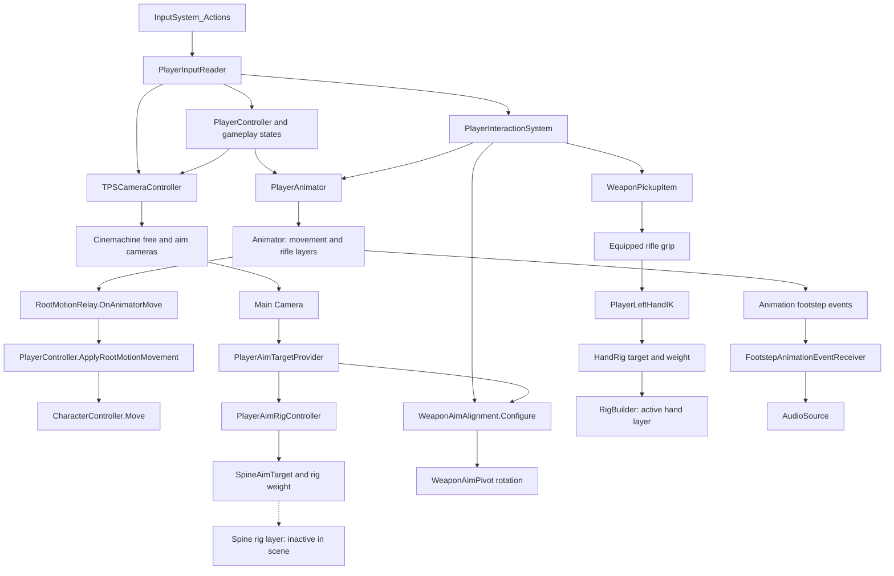

This is a dependency/workflow view, not a promise that every arrow executes in that top-to-bottom order within one frame. The rendered camera, animation evaluation, and late procedural corrections have timing considerations described below.

### 4.2 Ownership map

| Data or transform | Current owner/writer | Consumers and implications |
|---|---|---|
| Input snapshot | `PlayerInputReader` | States, camera, interaction, aim condition. |
| Gameplay action state | `PlayerStateMachine` inside controller | Locomotion, jump, dive-roll eligibility/behavior. |
| Ground/coyote/jump flags | `PlayerController` | Action guards and Animator grounded flag. |
| Vertical velocity | `PlayerController` | Applied only through root-motion movement route. |
| Horizontal displacement | Animator root delta, modified by `RootMotionRelay` | Controller combines it with jump carry and gravity. |
| Capsule displacement | `PlayerController.ApplyRootMotionMovement` | Sole first-party `CharacterController.Move` call found. |
| Player yaw | Controller rotation methods called by states | Root rotation can also write yaw if relay rotation is enabled; it is disabled in this scene. |
| Equipped weapon reference | `PlayerInteractionSystem` | Hand IK; pickup exclusion; future equipment state source. |
| Rifle gameplay gate | Animator `HasRifle` via `PlayerAnimator` | Used by controller `IsAiming`; not the same variable as `EquippedWeapon`. |
| Aim condition | `PlayerController.IsAiming` computed property | Camera, spine controller, weapon alignment, relay. |
| Animation aim bool | `PlayerAnimator.SetAiming`, called by locomotion state | May differ from computed aim while other states are active. |
| Main camera transform | Cinemachine Brain | Movement direction and shared aim sampling. |
| ADS target rotation | `TPSCameraController` | Aim virtual-camera setup. |
| Aim world point | `PlayerAimTargetProvider` | Shared spine target and weapon direction. |
| Spine target/weight | `PlayerAimRigController` | Spine constraint, if its rig layer is activated. |
| Weapon attachment | `WeaponPickupItem` at equip time | Rifle becomes a child of procedural pivot. |
| Weapon correction | `WeaponAimAlignment` | Writes `WeaponAimPivot` rotation in late phase. |
| Off-hand target/weight | `PlayerLeftHandIK` | Active hand rig. |

## 5. Script inventory and responsibilities

All paths in the following tables are relative to the project root. `PlayerStateId.cs` defines three types; the file count and type count therefore differ.

### 5.1 Input, controller, and state scripts

| Script | Responsibility and important API | Dependencies / lifecycle | Motion matching relevance |
|---|---|---|---|
| [PlayerInputReader.cs](Assets/Scripts/Player/PlayerInputReader.cs) | Reads `Move`, `Look`, sprint, jump, dive, interact, RMB. Exposes held/pressed/released snapshots. `LookAction` supports camera integration. | Order `-100`; enables actions in `OnEnable`, disables them in `OnDisable`, reads in `Update`. Look can fall back to `inputActionsAsset.FindAction("Player/Look")`. | Keep as the intent source; analog magnitude must be preserved into a future velocity predictor. |
| [PlayerController.cs](Assets/Scripts/Player/PlayerController.cs) | Caches capsule/references; registers states; owns ground query, coyote time, jump and dive guards, gravity, jump-forward carry, yaw helpers, root application, and computed `IsAiming`. | `Awake` -> registration; `Start` -> initial ground check/state; `Update` -> state tick; `LateUpdate` -> ground/timers/unlock. | Keep gameplay rules, but separate movement application and equipment state from animation implementation. |
| [PlayerStateId.cs](Assets/Scripts/Player/PlayerStateId.cs) | Defines `PlayerStateId`, `IPlayerState`, and `PlayerStateMachine`. Dictionary stores states; `ChangeState` calls old `Exit` then new `Enter`; `Tick` delegates. | Plain C# objects; controller owns the machine. Invalid/unregistered transitions silently return. | Preserve a high-level action machine; matching replaces clip selection, not all gameplay rules. |
| [PlayerLocomotionState.cs](Assets/Scripts/Player/PlayerLocomotionState.cs) | Prioritizes dive over jump, chooses facing mode, sets Animator aim flag, updates locomotion parameters. | `Tick` reads controller context/input. `Enter`/`Exit` are empty. | Primary seam for producing desired velocity/facing and selecting a locomotion backend. |
| [PlayerJumpState.cs](Assets/Scripts/Player/PlayerJumpState.cs) | On entry triggers animation and launches jump. Allows bounded transition to dive; updates move animation and facing; returns on grounded plus minimum state time. | Holds elapsed timer; uses `StartJump`, `CanStartDiveRoll`, and `IsGrounded`. | Keep initially as authored action with explicit ownership handoff. |
| [PlayerDiveRollState.cs](Assets/Scripts/Player/PlayerDiveRollState.cs) | Suppresses one horizontal root frame, chooses roll facing, triggers roll, starts downward/action flags, and exits after minimum time plus ground. | `Exit` clears `IsDiveRolling`. Updates locomotion blend values while rolling. | Keep initially; bypass grounded matching and prevent competing root writers. |

### 5.2 Animation and audio scripts

| Script | Responsibility and important API | Wiring / lifecycle | Motion matching relevance |
|---|---|---|---|
| [PlayerAnimator.cs](Assets/Scripts/Player/PlayerAnimator.cs) | Hashes parameter names; smooths `MoveX`, `MoveZ`, `Speed`; writes movement booleans, grounded/roll flags, triggers, `HasRifle`, and `isAiming`. Exposes `UnityAnimator`, `HasRifle`, `IsAiming`. | Attached with Animator; configured scene values described below. `HasRifle` startup value is deliberately not overwritten in `Awake`. | Split legacy locomotion driving from reusable action/upper-body control. Stop using Animator as authoritative equipment storage. |
| [RootMotionRelay.cs](Assets/Scripts/Player/RootMotionRelay.cs) | Captures `Animator.deltaPosition`/optional rotation; redirects aim-mode travel; suppresses idle drift; forwards movement to controller. | Same GameObject as Animator. `Awake` sets `applyRootMotion = true`; `OnAnimatorMove` supplies movement. | Critical adapter boundary. Replacement must preserve gravity/collision route and avoid double application. |
| [FootstepAnimationEventReceiver.cs](Assets/Scripts/Player/FootstepAnimationEventReceiver.cs) | `PlayFootstep`, `PlayLeftFootstep`, `PlayRightFootstep`, `ResetFootstepGate`; chooses audio and applies cooldown, transition, and independent ground-ray guards. | Animator/AudioSource on character; several `.anim` files call its public methods. | Reuse audio playback, but adapt event production to selected matching implementation. |
| [FootstepResetStateBehaviour.cs](Assets/Scripts/Player/FootstepResetStateBehaviour.cs) | Animator state entry/exit calls `ResetFootstepGate` on local receiver. | A `StateMachineBehaviour`, not a scene MonoBehaviour. Current inspected controller has empty behavior lists on states/state machines. | Script exists, but is not configured on this Animator. Do not assume it currently resets gates or will receive matching transitions. |

### 5.3 Camera, aim, and rig scripts

| Script | Responsibility and important API | Wiring / lifecycle | Motion matching relevance |
|---|---|---|---|
| [TPSCameraController.cs](Assets/Scripts/Player/TPSCameraController.cs) | Selects free/aim camera; synchronizes orientation at handoff; enables free look or manually rotates ADS target; shares Look action with Cinemachine. | Order `-50`; initialization in `Awake`/`Start`, decisions in `Update`. | Retain; use stable gameplay aim/facing data rather than an animation-owned rifle bool. |
| [PlayerAimTargetProvider.cs](Assets/Scripts/Player/PlayerAimTargetProvider.cs) | Publishes `AimPoint`, `AimDirection`, `AimRay`, `HasAimPoint`, `HitSomething`, `HitInfo`. Finds nearest valid camera-centre hit in fixed buffer or uses max-distance point. | Order `-10`, `Update`; `Camera.main` and own transform are fallbacks. | Retain shared targeting; establish camera sampling phase before adding a new animation graph. |
| [PlayerAimRigController.cs](Assets/Scripts/Player/PlayerAimRigController.cs) | Copies shared aim point to spine target while aiming and blends rig to `maxSpineRigWeight`. | Order `-1`, `Update`; starts rig weight at zero. Scene spine layer currently inactive. | Reuse above matching pose if graph integration supports the existing rig. |
| [PlayerLeftHandIK.cs](Assets/Scripts/Player/PlayerLeftHandIK.cs) | Copies equipped weapon grip pose to left-hand target and blends hand rig weight toward one. | `LateUpdate` at default order; starts rig weight at zero. | Retain concept, but validate timing relative to pose evaluation and final weapon correction. |
| [MouseWorldSphereTestMouseWorldSphereTest.cs](Assets/Scripts/Player/MouseWorldSphereTestMouseWorldSphereTest.cs) | Declares `MouseWorldSphereTest`; projects physical mouse position onto a fixed camera-depth plane and moves a debug sphere. | Legacy/debug code; no matching local-script component found in current `Test.unity`. File name differs from class name. | Not the active shared targeting route; avoid using it as migration aim authority. |

### 5.4 Weapon scripts

| Script | Responsibility and important API | Wiring / lifecycle | Motion matching relevance |
|---|---|---|---|
| [PlayerInteractionSystem.cs](Assets/Scripts/Player/PlayerInteractionSystem.cs) | Searches nearest pickup; handles Interact; calls attach; configures alignment; saves `EquippedWeapon`; sets Animator rifle flag. Also exposes `NearbyWeapon`, `HasWeapon`, `HasDetectedWeapon`. | Default-order `Update`; interaction buffer holds 10 colliders. Located in Player folder. | Keep pickup workflow; derive equipment state from gameplay rather than graph parameters. |
| [WeaponPickupItem.cs](Assets/Scripts/Gun/WeaponPickupItem.cs) | Owns root, local equip transform, muzzle, grip, and `IsEquipped`. Caches child physics; disables it and reparents root in `AttachToWeaponSocket`. | `Awake` caches components; attach is explicitly called. Method name still says socket but argument is the aim pivot. | Keep; make sure new rig/avatar keeps the attachment chain and grip references. |
| [WeaponAimAlignment.cs](Assets/Scripts/Gun/WeaponAimAlignment.cs) | Caches base pivot rotation, corrects muzzle toward shared target, restores base when aim ends, supports `Configure` and recache. | Order `10000`; `LateUpdate`. Missing references cause early return. Pickup-time configuration fills prefab references. | Keep visual correction, but validate phase and bounds against new poses. |
| [RifleAimAlignmentDebug.cs](Assets/Scripts/Gun/RifleAimAlignmentDebug.cs) | Draws desired/actual muzzle rays using the legacy mouse helper. | Disabled on rifle prefab and current scene instance; legacy provider reference is null. | Optional debug helper; would need a provider update before reuse. |

Some code comments describe older phases, for example no aiming in the controller or no IK yet in the weapon class. Current methods and serialized references take precedence over those comments.

## 6. UML: gameplay classes and dependencies

### 6.1 Movement and state classes

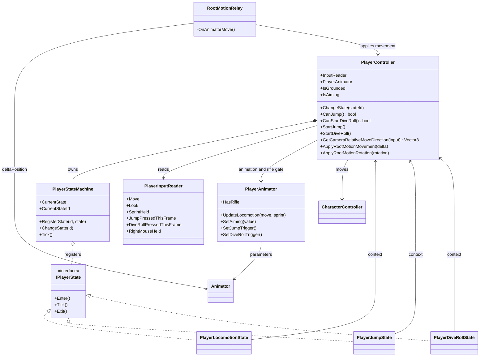

The states are instantiated with `new` during controller `Awake`; they are not components you add individually in the Inspector. The Animator and root relay live on the visual character, while the collision/gameplay controller lives on `PlayerRoot`.

### 6.2 Equipment, aim, and presentation dependencies

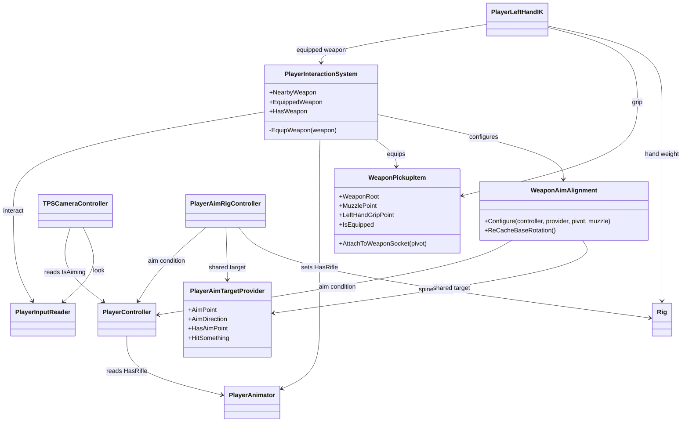

## 7. Initialization and frame execution

### 7.1 Startup responsibilities

1. Input component enables referenced actions when enabled.
2. Controller `Awake` caches components and constructs/registers Locomotion, Jump, DiveRoll states.
3. Animator wrapper `Awake` caches parameter hashes; it leaves the controller's configured `HasRifle` startup value alone. The current Animator asset defaults that bool to false.
4. Relay `Awake` locates the controller/Animator and enables root motion.
5. Interaction `Awake` resolves reader/Animator and defaults its interaction point if needed.
6. Camera `Awake` resolves camera components and assigns the reader's Look action to free-camera input axes named `Look Orbit X` and `Look Orbit Y`.
7. Aim provider resolves a rendered Camera and the ignored hierarchy root. Its scene `ignoredRoot` is null, so `Awake` defaults it to the component's `PlayerRoot` transform.
8. Rig controllers start their weights at zero. Weapon alignment caches a pivot base pose when it has a pivot; pickup later reconfigures and recaches it.
9. Controller `Start` checks ground, initializes coyote time if grounded, writes grounded status, and enters Locomotion.
10. Camera `Start` synchronizes the aim target, chooses free-camera priorities/input, and initializes its previous-aim flag.

Do not assume a dependable ordering among all default-order components. Fields that are serialized are more reliable than hoping another component has initialized first. A future adapter should have an explicit setup/evaluation contract.

### 7.2 Frame phases

| Phase/order | Current work | Consequence |
|---|---|---|
| `Update`, `-100` | Reader samples actions | Later gameplay consumers normally see this frame's input snapshot. |
| `Update`, `-50` | Camera controller checks computed aim, handles handoff, changes priorities/target rotation | This is camera intent setup; it does not itself guarantee the rendered Main Camera has already moved. |
| `Update`, `-10` | Shared provider samples Main Camera and performs raycast | Can use the previous rendered pose if Cinemachine finalizes later. |
| `Update`, `-1` | Spine controller copies target and blends weight | Scene's inactive spine rig layer remains a separate blocker. |
| `Update`, default | Controller ticks gameplay state; interaction detects/equips; other default components run | Ordering between controller and interaction is not explicitly established. |
| Animation evaluation | Animator evaluates layers and root delta; relay receives `OnAnimatorMove` | Horizontal motion, jump carry, and gravity are sent to capsule. |
| `LateUpdate`, default | Controller refreshes ground/timers; hand script copies grip/weight | State tick used ground information from the previous refresh. Hand target is sampled before weapon's order-10000 correction. |
| Cinemachine update/blend phase | Brain updates virtual/rendered camera according to its configuration | Exact effective relation to animation/target sampling needs Editor validation. |
| `LateUpdate`, `10000` | Weapon correction changes procedural pivot | Hand target may already have sampled an earlier grip pose. |

Unity documents `OnAnimatorMove` as occurring after state-machine/animation evaluation and before `OnAnimatorIK`. This supports treating it as an animation-evaluation callback, not as a general substitute for `Update`. See [Unity callback documentation](https://docs.unity.com/en-us/engine/6000.0/script-reference/unityengine/monobehaviour/onanimatormove).

The scene Animator has `m_UpdateMode: 0`. The Brain serializes `UpdateMethod: 2` and `BlendUpdateMethod: 1`; those raw settings alone are not runtime proof of which camera pose the provider actually sampled. Negative execution orders organize script callbacks within a phase; they do not force the complete camera/animation pipeline to finish early.

### 7.3 UML sequence: an ordinary locomotion frame

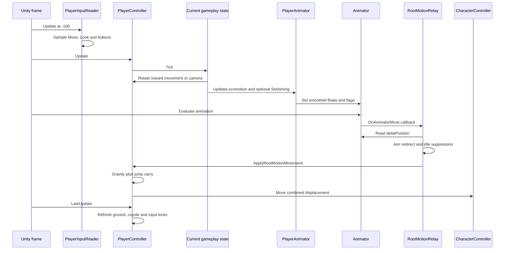

The sequence omits camera, interaction, audio, and rig work to isolate the dependency that matters most to movement migration.

## 8. Locomotion, jump, gravity, and dive roll

### 8.1 Input bindings actually consumed

| Gameplay intent | Keyboard/mouse | Additional binding present | Current use |
|---|---|---|---|
| Move | WASD and arrow keys | Gamepad left stick; other device bindings | Read and consumed. |
| Look | Pointer delta | Gamepad right stick / joystick hat | Read; ADS sensitivity is mouse-style, so controller tuning still needs testing. |
| Sprint | Left Shift | Gamepad left-stick press; XR trigger | Read and consumed by animation logic. |
| Jump | Space | Gamepad south button; XR secondary button | Read and consumed by jump guard. |
| Dive roll | Tab | No gamepad dive binding found | Read and consumed by state logic. |
| Interact | E | Gamepad north button | Read and consumed by pickup. |
| Aim | Right mouse button | No gamepad aim binding found on this action | `RightMouse` action read by reader. |

`Attack`, `LeftMouse`, `Crouch`, `Previous`, and `Next` exist in the Player action map but are not read by `PlayerInputReader`. UI has its own action map and scene event-system wiring. An attack binding does not mean shooting is implemented.

### 8.2 Ground locomotion

`PlayerLocomotionState.Tick` reads Move, SprintHeld, and the controller's computed aim condition. It checks dive activation before jump activation; if both valid presses happen in the same tick, dive wins.

Without an action transition, facing follows one of two rules:

- Free mode: turn toward camera-relative movement while movement input exists.
- Aim mode: turn toward the camera's flattened forward direction, including when stationary.

The direction calculation projects camera forward and right onto the ground plane, normalizes them, combines them with input X/Y, and normalizes the result. Missing camera falls back to player-relative forward/right. Inputs below the `0.01` squared-magnitude threshold return zero. Thus the returned direction intentionally loses analog magnitude.

Rotation uses exponential smoothing, `t = 1 - exp(-rotationSharpness * dt)`, then Quaternion Slerp. Scene sharpness is `18`.

The state then calls `SetAiming(isAiming)` and `UpdateLocomotion(moveInput, isSprinting)`. It does not directly translate the character.

### 8.3 How travel distance is produced

The relay reads animation displacement. Normally it forwards that world displacement. While computed aim is true, it replaces horizontal direction with camera-relative input direction while preserving the root delta's horizontal length:

```text
strideDistance = length(animatorDelta.xz)
aimDirection = GetCameraRelativeMoveDirection(input)
horizontalDelta = aimDirection * strideDistance
```

Then, if enabled and Animator `abs(Speed) < 0.01`, the relay zeroes that animation delta to prevent idle drift. It can discard root Y; the controller also always discards root Y.

The controller combines:

```text
finalDelta = filteredAnimationDeltaXZ
           + jumpForwardVelocity * dt
           + worldUp * verticalVelocity * dt
```

It calls `CharacterController.Move(finalDelta)` once along this route. Horizontal jump carry decays toward zero while airborne and is cleared when grounded.

This means walk/sprint clip root curves, blend weights, and state playback speed affect actual speed. `Speed = 1` is an animation control value, not `1 m/s`.

### 8.4 Gravity and grounding

`RefreshGroundCheck` uses `Physics.CheckSphere`, a configured point/radius, the Ground layer mask, and ignored triggers. It does not use `CharacterController.isGrounded` as its source of truth. A positive ground-ignore timer forces grounded false temporarily.

Gravity integration occurs in `ApplyRootMotionMovement`:

```text
if grounded and verticalVelocity < 0:
    verticalVelocity = groundedGravity
else:
    verticalVelocity += gravity * dt
```

Current scene gravity is `-25`, while grounded downward velocity is `-13`, substantially stronger than the source-code default `-2`. Grounding/coyote refresh happens in `LateUpdate`; the state `Update` and movement callback normally use the prior stored grounded result.

Grounded and non-rising refresh restores coyote time and clears consumed jump/dive flags. Otherwise coyote time counts down to zero. Jump lock clears when Jump is released or is no longer held.

### 8.5 Jump eligibility and execution

`CanJump()` requires all of the following:

1. Current time is past `nextAllowedJumpTime`.
2. Input is not locked.
3. This jump has not been consumed.
4. Coyote timer is positive.

Entering Jump sets the Animator trigger and grounded false, then `StartJump()`:

- consumes and locks jump;
- applies the retrigger block and records start time;
- clears coyote time;
- ignores ground briefly;
- sets `verticalVelocity = sqrt(jumpHeight * -2 * gravity)`;
- chooses camera-relative launch direction, or player forward without input;
- sets horizontal jump carry using `jumpForwardForce`;
- marks grounded false.

With scene height `1.4` and gravity `-25`, the initial vertical speed is approximately `8.37 m/s`. This is the mathematical launch value, not a measured apex height under collisions and frame timing. Scene horizontal launch force is `5`.

Jump `Tick` may enter DiveRoll within its eligibility window, rotates toward move input, and keeps updating movement animation parameters. It returns to Locomotion when grounded and elapsed state time is at least `0.15 s`.

There is no independent gameplay Fall state. Walking off an edge stays in the existing gameplay state while gravity continues through the animation callback.

### 8.6 Dive-roll eligibility and execution

`CanStartDiveRoll()` rejects consumed rolls. Grounded activation is allowed. Air activation requires a consumed jump and time since jump between `0.08 s` and `0.5 s`.

On entry, the state:

1. requests one horizontal root-motion frame be ignored;
2. selects camera-relative move direction or player forward;
3. calls the smoothed facing method once;
4. triggers roll and sets rolling true;
5. calls `StartDiveRoll`, which consumes roll, locks jump, clears coyote time, forces vertical speed to at most `-3`, and marks grounded false.

The state exits when grounded and elapsed state time is at least `0.9 s`; `Exit` clears the Animator rolling bool. This is a gameplay timer and ground condition, not a direct wait for animation normalized time. Animator Dive Roll playback speed is separately `1.4`.

`RotateTowardsDirection` is smoothed, so the single entry call does not guarantee an instantaneous turn all the way toward the requested roll direction. Capsule dimensions are not changed for the roll.

### 8.7 UML gameplay-state diagram

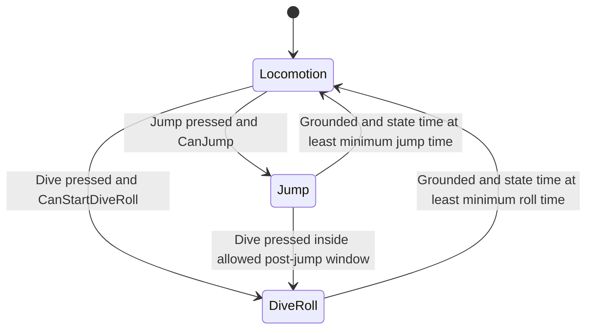

`Fall` and `Crouch` are omitted because they are not registered states. Rifle ownership and aiming are flags/conditions, not separate C# states. An unregistered requested state is ignored by `PlayerStateMachine.ChangeState`.

## 9. Animator architecture and animation data

### 9.1 Parameters and meaning

The assigned controller is [PlayerController.controller](Assets/Scripts/Player/Animation/PlayerController.controller).

| Parameter | Type | Writer/use |
|---|---|---|
| `MoveX` | Float | Smoothed signed horizontal blend coordinate. |
| `MoveZ` | Float | Smoothed signed forward/back blend coordinate. |
| `Speed` | Float | Smoothed nominal gait value; also read by relay idle gate. |
| `IsMoving` | Bool | Raw move threshold result. |
| `IsSprinting` | Bool | Effective sprint after optional rifle restrictions. |
| `IsGrounded` | Bool | Controller ground status; used for Jump exit. |
| `Jump` | Trigger | Jump action entry; counterpart roll trigger is reset. |
| `DiveRoll` | Trigger | Dive action entry; counterpart jump trigger is reset. |
| `IsDiveRolling` | Bool | Gameplay roll lifetime; controls Animator exit. |
| `HasRifle` | Bool | Set on equip; selects rifle locomotion and gates gameplay aim. |
| `isAiming` | Bool | Case-sensitive name; written by Locomotion state, controls rifle overlay. |

All these asset defaults are zero/false. No `FootstepVolume` float exists in this controller, although the receiver can optionally read it; that option is disabled in the scene. No `Blend` parameter exists, although an empty, unreferenced-looking blend-tree object uses that name.

### 9.2 Parameter generation

`PlayerAnimator.UpdateLocomotion` clamps input vector magnitude to one, determines movement, and chooses nominal gait `0`, `0.5`, or `1`. It multiplies input X/Y by that gait value and exponentially smooths all three float values using `dampSpeed = 12`.

The rifle forward-only sprint restriction exists in code but **is disabled in the scene** (`rifleSprintForwardOnly: 0`). If enabled later, it requires forward input at least `0.8` and absolute side input at most `0.25`. Do not describe the current scene as enforcing forward-only rifle sprint.

`IsMoving`/`IsSprinting` are written, but the inspected Animator transitions use rifle, aim, grounded, jump, dive, and rolling conditions. Writing a parameter does not prove the graph consumes it for state transitions.

### 9.3 Layer structure

| Layer | Contents | Configuration |
|---|---|---|
| `MovementLayer` | `Locomotion`, `RifleLocomotion `, `Jump`, `Dive Roll` | Base movement layer; no mask. The rifle state name actually has a trailing space. |
| `RifleLayer` | Empty `New State`, `Rifle Aiming Idle 1` | Override blend mode; default weight `1`; assigned `RifleUpperBodyMask`. |

Movement Locomotion is the default base state. RifleLayer defaults to the empty state. Jump and Dive Roll can be entered through Any State transitions triggered by gameplay.

The mask's Humanoid selection excludes lower-body regions, but its transform list contains some enabled descendant leg transforms. Validate actual masking in the Editor and with the chosen animation graph; the file name alone is not proof that every possible transform path is isolated from locomotion.

### 9.4 Blend-tree sample map

Both active movement trees serialize `m_BlendType: 2` and use `MoveX`/`MoveZ`, representing a 2D Freeform Directional setup.

| Direction/sample | Unarmed tree | Rifle tree |
|---|---|---|
| Idle `(0, 0)` | `Idle.anim` | `Basic Shooter Pack/Rifle Idle 1.anim` |
| Forward walk | `(0, 0.5)` `walking.anim` | `(0, 0.3)` `Rwalk.anim` |
| Forward intermediate | No separate middle sample | `(0, 0.7)` `Rrun.anim` |
| Forward fast | `(0, 1)` `Fast Run.anim` | `(0, 1)` `Pro Rifle Pack/SprinForward.anim` |
| Backward walk | `(0, -0.5)` `Walking Backward.anim` | `(0, -0.3)` `RwalkBack.anim` |
| Backward intermediate | No separate middle sample | `(0, -0.7)` `RrunBackwards.anim` |
| Backward fast | `(0, -1)` `Run Backward.anim` | `(0, -1)` `SprintBackward.anim` |
| Left walk | `(-0.5, 0)` `LeftStraffe.anim` | `(-0.3, 0)` `RifleLeft.anim` |
| Left intermediate | No separate middle sample | `(-0.7, 0)` `RunLeft.anim` |
| Left fast | `(-1, 0)` `LeftStraffRun.anim` | `(-1, 0)` `SprinLeft.anim` |
| Right walk | `(0.5, 0)` `RightStraffe.anim` | `(0.3, 0)` `RilfleRight.anim` |
| Right intermediate | No separate middle sample | `(0.7, 0)` `RunRight.anim` |
| Right fast | `(1, 0)` `RightStraffeRun.anim` | `(1, 0)` `SprintRight.anim` |

Unqualified clip paths above are relative to `Assets/Scripts/Player/Animation`; rifle side/fast clips not marked Basic Shooter are in `Pro Rifle Pack`.

There are nine unarmed samples and thirteen rifle samples. No explicit diagonal samples are serialized in these trees; directional combinations are produced by blending existing samples. The wrapper's nominal walk value `0.5` falls between rifle samples `0.3` and `0.7`, so “rifle walk” input can mix those two authored gaits. Rifle locomotion state playback speed is `0.9`, another factor in travel rate.

### 9.5 UML Animator-state diagram

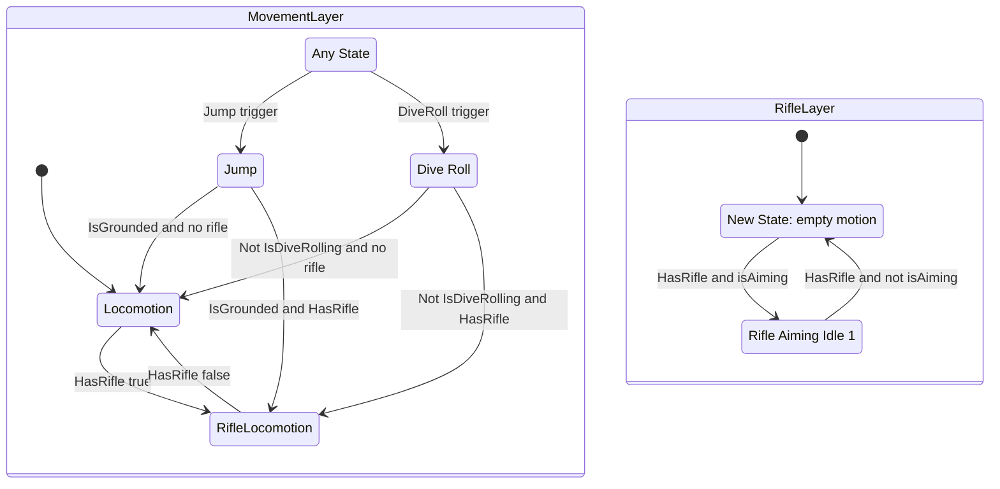

`Any State` above represents Animator Any State transitions, not a custom gameplay state. The two layer boxes describe separate layer graphs, not a transition between layers.

Jump transition duration is `0.03`; Dive Roll entry is `0.05`. Rifle/unarmed switching and most Jump exits use `0.1`. Roll-to-rifle and overlay transitions are zero-duration. These inspected transitions do not require exit time; their serialized exit-time numbers are therefore not active waiting conditions.

The overlay exit requires `HasRifle == true` and `isAiming == false`; there is no explicit “rifle removed” exit. That is not currently exercised by a drop feature, because none exists, but it matters if equipment lifecycle expands.

### 9.6 Footstep workflow

Several unarmed movement clips contain `PlayFootstep` events, with one inspected right-strafe run event using `PlayRightFootstep`. Event methods select configured clips, randomize pitch, and play an AudioSource.

Playback is gated by a reset block, a minimum interval, optional Animator transition rejection, and an independent downward ground ray. Scene effective interval is `max(0.08, 0.14) = 0.14 s`; transition reset delay is `0.08 s`. The receiver uses a `0.6 m` ray and the Ground mask.

`FootstepResetStateBehaviour` exists but is not assigned in the current Animator controller. Transition checks inside the receiver still exist independently. Do not assume all rifle clips have correctly placed footstep events; that requires a full event audit and playback validation.

## 10. Pickup, camera, aiming, and IK

### 10.1 Equip workflow and UML sequence

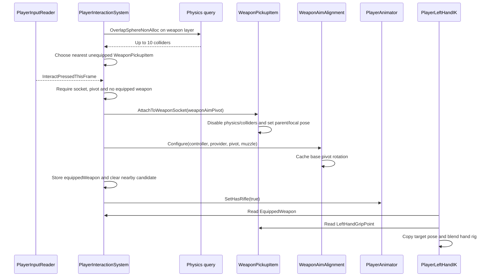

The overlap query runs each update around `InteractionPoint`, radius `1.5`, on layer 7 (`WeaponLayer`, mask `128`), including triggers. Candidates are identified with `GetComponentInParent<WeaponPickupItem>()`; already equipped candidates are ignored. “Nearest” means root-position distance among returned colliders, not an unlimited scene-wide search.

If a weapon is already equipped, additional pickup is rejected. There is no drop/replace path. Attachment zeros Rigidbody velocities, disables gravity, makes rigidbodies kinematic, disables colliders when configured, parents the root, and applies weapon-specific local position/rotation/scale. Current rifle equip offsets are zero position/rotation and unit scale.

`Configure` is significant: the reusable rifle prefab has null player/provider/pivot/muzzle alignment fields, but the scene instance supplies overrides and pickup supplies runtime values. Null prefab defaults alone are not a confirmed broken equip path.

### 10.2 Aim condition and target

The gameplay condition is:

```text
PlayerController.IsAiming = playerAnimator.HasRifle AND inputReader.RightMouseHeld
```

It is not currently `EquippedWeapon != null AND RMB`, and it is not restricted to Locomotion. Camera, root relay, spine controller, and weapon correction can therefore consider the player aiming during jump or dive.

`PlayerAimTargetProvider` samples viewport centre `(0.5, 0.5)` from Main Camera. It performs a non-alloc raycast into 16 hit slots, skips colliders under the ignored root, and chooses the closest remaining result. On miss it publishes a point `200 m` down the ray.

`HasAimPoint` means a camera ray/fallback target was produced; it does not imply a hit. `HitSomething` distinguishes hits from fallback. `AimDirection` is the camera ray direction, not the muzzle-to-target vector.

The ignored root defaults to `PlayerRoot`, so equipped child weapon colliders fall within that ignored hierarchy, in addition to normally being disabled on pickup. Ground and aim queries ignore triggers; pickup overlap includes them.

### 10.3 Camera handoff

Free look uses Cinemachine's input-axis controller and shared Look action. On aim entry, `SyncAimTargetWithCamera` raycasts from rendered camera centre, rotates the aim target toward the resulting point, then raises aim camera priority above free camera (`20` versus `10`). Free-camera input is disabled while ADS is active.

During ADS, the script accumulates yaw and pitch from Look, clamps pitch to `[-35, 70]`, and rotates `AimCameraTarget`. The scene sensitivity is `0.001`, while source default is `0.08`; the serialized value is the effective baseline.

On aim exit, the script synchronizes free-orbit horizontal/vertical axes from the current rendered camera and lowers aim priority to zero. It deliberately does not continuously resynchronize aim target while free-looking: the current comment identifies feedback through Cinemachine blends as the reason.

Camera handoff performs its own single `Physics.Raycast` using `aimSyncLayers`; unlike the shared provider, that helper has no explicit self-hierarchy rejection. Those two ray queries can disagree near the player or obstructing geometry, despite the shared continuous aim design.

### 10.4 Body, rifle, and hand workflow

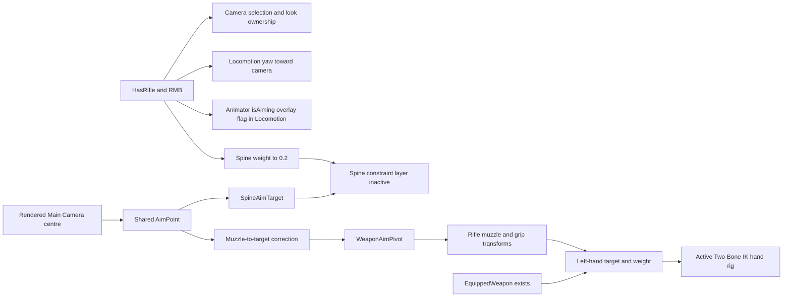

Hand IK depends on equipment, not RMB: it stays engaged while holding the weapon. Spine weight depends on computed aim, up to `0.2`, but its layer currently does not evaluate. An upper-body animation overlay is a separate presentation system and can still affect the torso even with the spine rig inactive.

### 10.5 Weapon correction math

The weapon alignment solver starts each frame from its cached base pivot local rotation. After that reset it calculates:

```text
desiredDirection = normalize(AimPoint - muzzlePositionAtBasePose)
correction = FromToRotation(baseMuzzleForward, desiredDirection)
targetPivotWorldRotation = correction * basePivotWorldRotation
```

It restores the previous visual rotation before either directly assigning the target (`instantAlignmentForDebug`, source default true) or exponentially smoothing toward it. On release it restores/blends toward cached base local rotation. This avoids accumulating correction on top of the previous corrected pose.

It is a visual correction, not a shooting system. Because rotating an offset pivot can also move the muzzle, one correction computed at the base muzzle position does not mathematically prove the final muzzle ray intersects a nearby target exactly. Verify final angular error and near-target behavior in Play Mode before treating the barrel as shot authority.

## 11. Actual scene wiring and Inspector values

### 11.1 Relevant hierarchy

This is a focused hierarchy reconstruction from serialized Transform parent references. Unrelated meshes, finger bones, environment objects, and UI are omitted.

```text
PlayerRoot
  PlayerInputReader, PlayerController, CharacterController
  PlayerInteractionSystem, TPSCameraController
  PlayerAimTargetProvider, PlayerAimRigController, PlayerLeftHandIK
  CheckPoint                          Ground check
  InteractionPoint
  AimCameraTarget
  RigTargets/
    SpineAimTarget
  Visual /                            Actual name includes a trailing space
    Ch15_nonPBR/
      Animator, PlayerAnimator, RootMotionRelay
      RigBuilder, FootstepAnimationEventReceiver, AudioSource
      mixamorig:Hips/.../mixamorig:Spine2
        .../mixamorig:RightHand/
          weaponSocket/
            WeaponAimPivot/
              ar15                    Added here at runtime on pickup
      SpineRig/
        SpineAimConstraint            Multi-Aim Constraint
      HandRig/
        LeftHandRig/                  Two Bone IK constraint
          LeftHandRig_target
          LeftHandRig_hint

CameraSystem                          Camera-system grouping exists in scene
Main Camera                           Camera and CinemachineBrain
TPSCamera                             Free Cinemachine camera
TPSAimCamera                          Aim Cinemachine camera
Environment / rifle pickup            Scene content before equip
```

Camera entries above list relevant objects without asserting that all are siblings directly under `CameraSystem`. The verified character attachment path is `RightHand -> weaponSocket -> WeaponAimPivot`. The rifle is a world pickup at startup and is reparented during equip.

### 11.2 Scene-specific configuration

| Component/area | Serialized value | Why it matters |
|---|---|---|
| Controller ground point | `CheckPoint`, radius `0.13` | Source radius default is `0.25`; migration comparisons should use scene value. |
| Ground mask | `64`, layer 6 `Ground` | Ground contact depends on collider layers. |
| Jump | Height `1.4`, coyote `0.12`, min state `0.15` | Preserve action feel until intentional retuning. |
| Jump ignore/cooldown | `0.12` / `0.25 s` | Prevents immediate reground/retrigger. |
| Jump forward carry | Force `5`, damping `8` | Carries horizontal travel beyond clip root delta. |
| Dive | Window `0.5`, minimum delay `0.08`, minimum state `0.9` | Separate eligibility and action lifetime. |
| Vertical movement | Gravity `-25`, grounded gravity `-13`, dive downward `-3` | Values belong to gameplay simulation, not matching features. |
| Capsule | Height `2`, radius `0.18`, centre Y `1.09` | Action animation does not resize the collider. |
| Capsule traversal | Slope `45`, step `0.3`, skin `0.08` | Preserve during initial motor integration. |
| Relay | Movement on, root rotation off, Y ignored, idle suppression on | Existing root authority contract. |
| Animator | Root motion on, update mode `0` | New graph must integrate without duplicate root application. |
| Animator wrapper | Gait `0/0.5/1`, damping `12` | Dimensionless blend controls. |
| Rifle sprint restriction | Disabled | Side/back sprint samples can be reached. |
| Camera | Free priority `10`, aim `20`, sensitivity `0.001` | Scene differs from source sensitivity default. |
| Shared target | Main Camera, max `200`, all-layer mask, triggers ignored | Player hierarchy is ignored by code fallback. |
| Spine controller | Provider and spine rig assigned; max weight `0.2` | Assignment exists, but evaluation layer is off. |
| RigBuilder spine layer | `m_Rig: 1011703230`, `m_Active: 0` | No script in the inspected first-party code reactivates it. |
| RigBuilder hand layer | `m_Rig: 1607917325`, `m_Active: 1` | Active rig chain for off-hand. |
| Spine constraint | Spine2, shared target, limits `-45..45`, maintained offset | Target/axes need pose validation if activated. |
| Interaction | Radius `1.5`, mask `128` | Queries WeaponLayer pickups. |
| Interaction attachment fields | Both socket and pivot are `fileID: 2084462327` | Both reference `WeaponAimPivot`, although a separate parent `weaponSocket` exists. |
| Hand IK | Grip target assigned, blend speed `10` | Updates in default-order LateUpdate. |
| Footstep | Volume `8`, pitch variation `0.25` | Unusually high volume setting; actual sound level was not assessed. |
| Footstep ground | Ray `0.6`, Ground mask `64` | Independent from controller sphere test. |
| Legacy rifle debug | Disabled, old aim provider null | Not part of the current active chain. |

The duplicate socket/pivot Inspector assignment does not currently prevent attachment: the code parents to the pivot and only checks the socket for non-null. It does make the intended distinction less explicit for future wiring.

## 12. Risks and unresolved behavior

These are migration-focused observations. Severity concerns likely impact if the condition is exercised; confidence distinguishes directly visible configuration/code from unverified runtime symptoms. No fixes were applied.

| ID | Severity / confidence | Evidence and impact | Recommended action / size | Validation |
|---|---|---|---|---|
| R1 | High / confirmed structural dependency | `ApplyGravity` and capsule movement are reached through relay callback. Disabling relay movement returns before both. | Define one movement owner and explicit vertical simulation route before graph replacement. Medium. | Disable/replace old locomotion route in a controlled test; verify falling, stationary jump, landing, and no duplicate integration. |
| R2 | High / confirmed coupling | `IsAiming` reads Animator `HasRifle`; interaction separately owns actual weapon reference. | Establish gameplay equipment/aim state, then mirror flags into animation. Medium. | Equip and aim while switching animation backend; no loss of aim or false equipped state. |
| R3 | Medium / confirmed configuration | Spine rig exists and is assigned, but RigBuilder spine layer `m_Active` is zero. | Decide intended torso-rig use and activate/configure during an explicitly scoped implementation. Small to medium. | Observe constrained Spine2 and rig weight with layer enabled/disabled. |
| R4 | Medium / likely timing risk | Provider samples camera in Update; weapon corrects at LateUpdate order `10000`; hand target samples earlier; rig graph evaluation phase is not explicitly coordinated. | Define camera, pose, weapon, and hand-target evaluation phases. Medium. | Rapid camera motion, strafing, ADS handoffs: measure reticle/barrel/hand lag. |
| R5 | Medium / confirmed code scope, symptom unverified | Relay aim redirection and Speed idle gate apply to every state. Jump/roll also update locomotion Speed. | Scope locomotion filtering by movement/action ownership so actions can retain intended root motion. Small to medium. | Roll from idle, release movement during roll, aim during roll/jump, stationary landing. |
| R6 | Medium / confirmed dependency and possible stale presentation | Only Locomotion writes Animator `isAiming`; computed aim remains readable in Jump/DiveRoll. | Define aim-during-action policy and update presentation consistently. Small to medium. | Press/release RMB while airborne/rolling; compare camera, Animator flag, torso, and weapon. |
| R7 | Medium / confirmed missing implementation | Enum/input placeholders for Fall/Crouch exist without registered states; no matching runtime/database. | Treat as future scope, not completed capability. Large for full matching migration; action additions separate. | Track milestone acceptance independently for implemented actions. |
| R8 | Medium / confirmed configuration, runtime effect unknown | Rifle mask has mixed transform weights; state Write Defaults settings are mixed; no state reset behaviors are assigned. | Verify mask isolation and action/overlay reset behavior with actual rig. Medium. | Watch feet/root during ADS, jump, roll, and backend handoff. |
| R9 | Medium / possible geometry mismatch | Weapon correction computes desired ray before final pivot rotation moves offset muzzle. | Measure final muzzle-to-target error before adding firing; bound/rework correction if needed. Medium. | Near/far target sweep, camera pitch extremes, weapon near cover. |
| R10 | Low / confirmed bounded-query design | Overlap buffer 10; aim ray buffer 16; neither grows or detects saturation. | Keep bounds visible and test representative crowded scenes; change only if needed. Small. | Place more candidates/hits than capacity and verify selection expectations. |
| R11 | Low / confirmed wiring ambiguity | Interaction socket field points to pivot rather than distinct parent socket. | Make scene references and field intent consistent during wiring cleanup. Small. | Equip and verify hierarchy and cached base pivot after reassigning. |
| R12 | Medium / unknown baseline | No first-party tests/CI found; live Editor unavailable; no runtime baseline captured. | Record baseline behavior and add focused regression coverage when implementing movement changes. Medium. | Compile, run action matrix, profile matching, and build target platform. |

Additional practical checks:

- A full capsule remains present during dive roll. Visual clearance under obstacles is not guaranteed by the animation.
- Ground queries and footstep queries use different shapes, locations, and distances, so they can disagree at edges/slopes.
- No first-party root translation outside `CharacterController.Move` was found, but new plugins may introduce their own root writer. Recheck after integration.
- Scene source is not live Editor memory. Unsaved Inspector changes would not appear in this report.
- Deleted/modified animation and metadata files exist in the working tree. Motion-database work should use a reproducible asset snapshot and verify references; this report does not conclude that those in-progress edits are broken.

Useful existing strengths are the single input reader, centralized capsule movement call, explicit gameplay action guards, fixed-buffer physics queries, shared aim point, a separate procedural weapon pivot, and a reusable hand-grip target. These provide concrete seams for migration without rewriting every player system.

## 13. What motion matching changes

### 13.1 Conceptual change

Motion matching selects a suitable frame from animation data using a query that describes the current pose and desired trajectory. It then transitions playback to the selected result. Unlike the current manually arranged blend trees, selection can account for starts, stops, turns, and pose continuity together. It still needs appropriate source motion; it cannot supply missing movement styles just because a matching algorithm is present. These concepts are described in [Ubisoft La Forge's motion matching explanation](https://www.ubisoft.com/en-us/studio/laforge/news/6xXL85Q3bF2vEj76xmnmIu/introducing-learned-motion-matching).

For this project, the design implication is to replace **grounded locomotion pose selection** first, while preserving gameplay action eligibility, collision, camera intent, equipment, and aim targeting.

| Current system | Proposed matching integration |
|---|---|
| Input scaled into `MoveX`/`MoveZ` | Input converted into desired world velocity and separate facing. |
| Gait represented as `0`, `0.5`, `1` | Desired speed/gait has explicit units and policy. |
| Fixed directional blend-tree samples | Pose and trajectory query against a baked motion dataset. |
| Animator transition graph chooses grounded clips | Matching backend chooses grounded animation frames. |
| Root delta supplied by existing Animator | Root delta supplied through one selected animation/movement contract. |
| Animation events produce footsteps | Backend-compatible events, contacts, or an explicit bridge produce footsteps. |
| Rifle bool partly owns gameplay state | Gameplay equipment state supplies filters/flags to animation. |
| Jump/roll coupled to Animator states | Authored action overrides with explicit handoff during initial migration. |

### 13.2 Desired movement and desired facing must be separate

Free movement and ADS already imply different policies:

```text
Free locomotion:
    desired velocity = camera-relative input * chosen speed
    desired facing = movement direction when moving

ADS locomotion:
    desired velocity = camera-relative input * chosen speed
    desired facing = horizontal aim/camera direction
```

In ADS, left input should predict leftward travel while facing remains forward toward aim. A predictor that always faces travel would destroy strafe behavior. A predictor that ignores facing would lose the distinction between backward movement and turning around.

This is a proposed contract derived from current behavior, not a class that already exists. Analog stick magnitude should remain available; the current normalized direction helper alone is insufficient to represent desired speed.

### 13.3 Animation data preparation

Before baking a database, inventory clips by actual usable content, not filenames. Candidate data should be classified for:

- Idle, starts, sustained walk/run/sprint, deceleration, and stops.
- Turning while moving, sharp direction changes, pivots, and turn in place where required.
- Rifle versus unarmed posture, including ADS strafe/backward motion.
- Root displacement/rotation, skeleton compatibility, clip scale, foot contacts, and loop boundaries.
- Authored jump/dive actions kept outside grounded matching at first.

The project contains turn and run-to-stop assets in imported packs, but their coverage/quality has not been sampled visually. Existing directional loops are useful candidates; they do not by themselves establish smooth start/stop or pivot coverage.

For a first proof of concept, choose a small coherent grounded subset on the current avatar. Normalize import conventions and identify clip boundaries before attempting to ingest all 109 FBX files. Dataset size, search rate, feature normalization, and memory budget must be measured against the chosen implementation and target hardware; this report sets no unsupported performance numbers.

### 13.4 Feature/query design to review

The following are proposed project inputs to evaluate with the selected matching backend:

| Input | Project reason |
|---|---|
| Current root/pelvis velocity | Preserve momentum and distinguish standstill from travel. |
| Current foot pose/velocity or backend pose features | Preserve continuity and support contact-aware selection. |
| Future trajectory positions | Express where input intends the capsule to travel. |
| Future facing directions | Distinguish free turns from ADS strafing. |
| Gait / desired speed | Preserve walk/sprint policy without using blend coordinates as metres per second. |
| Equipment/aim tags | Choose an appropriate grounded posture set. |
| Action eligibility | Exclude grounded matching while authored jump/dive owns animation. |
| Actual collision-resolved displacement | Correct prediction when movement is blocked. |

Use the backend's supported feature schema, coordinate system, sample times, and baking rules. If designing a custom matcher, a weighted normalized distance is a useful starting abstraction:

```text
candidateCost = trajectoryError
              + poseContinuityError
              + velocityError
              + facingError
              + optionalTransitionPenalty
```

This is design pseudocode, not an implementation or tuned formula. Weighting, normalization, exclusions, continuation bias, and search frequency require concrete backend/data decisions. An ordinary motion matching migration does not require choosing a learned/neural implementation; [Ubisoft's research summary](https://www.ubisoft.com/en-us/studio/laforge/news/3NWqwcMU9lMfumgfPAEfka/learned-motion-matching) treats learned motion matching as an alternative to the database-based algorithm.

## 14. Proposed migration architecture

All names in this section that do not appear in the script inventory are **proposed roles**, not existing scripts or promised plugin APIs. A selected backend may combine them or name them differently.

### 14.1 Target workflow

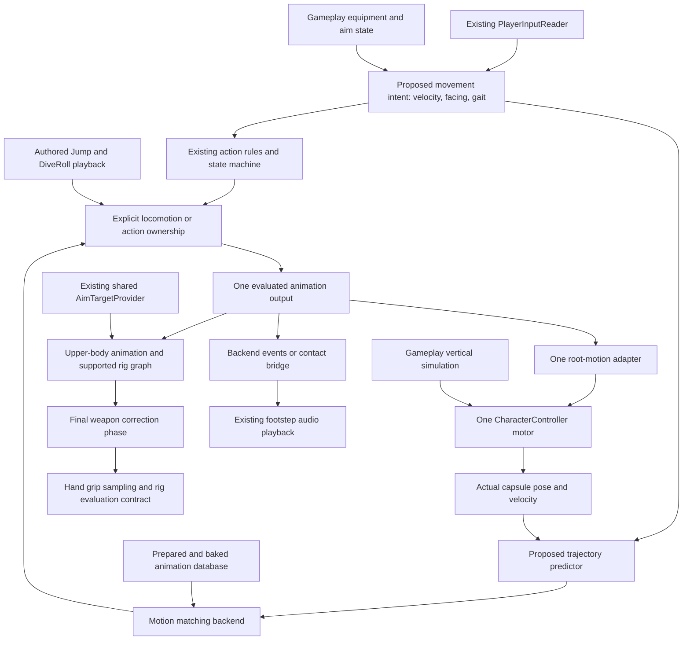

The hand box is a contract to solve, not an instruction to call the current `LateUpdate` method later and assume the already-evaluated rig updates immediately. If a backend evaluates its graph before a target is written, explicit graph integration or different target preparation is required.

### 14.2 Proposed responsibilities

| Proposed role | Responsibility | Existing code it would connect to |
|---|---|---|
| `PlayerMovementIntent` | Requested velocity, facing, gait, aim/equipment mode, action request; no direct transform writes. | Reader, controller helpers, gameplay equipment state. |
| `PlayerMotor` | Sole capsule movement and vertical simulation owner; exposes actual displacement/grounding. | Extract/adapt controller movement, gravity, jump carry, ground rules. |
| `TrajectoryPredictor` | Predicts future travel/facing in backend-required coordinates, reconciles actual motion. | Intent and motor state. |
| `LocomotionAnimationAdapter` | Wraps legacy or matching grounded animation backend; exposes outputs consistently. | Existing `PlayerAnimator` locomotion calls and new backend. |
| `ActionAnimationCoordinator` | Suspends grounded matching for jump/roll, controls action playback, returns pose/root authority. | Existing Jump/DiveRoll state entry/exit. |
| `PlayerEquipmentState` | Authoritative equipped/aim state, independent of Animator graph. | Interaction `EquippedWeapon` and reader RMB; may initially be a small controller refactor rather than a new component. |
| `FootContactBridge` | Converts backend contact/events to audio calls with deduplication. | Footstep receiver. |

### 14.3 UML for proposed integration contracts

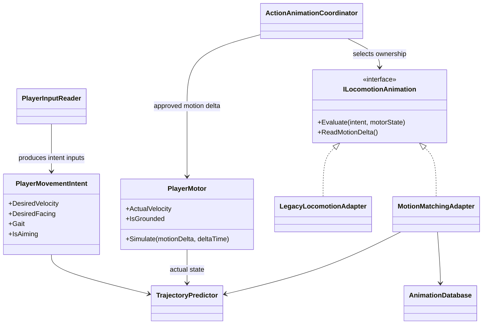

Interface names and method signatures illustrate boundaries only. They must be adapted to the selected backend's evaluation schedule; do not add a second graph evaluation just to conform to this sketch.

### 14.4 Root-motion and physics contract

Choose one horizontal motion policy explicitly:

| Policy | Operation | Project tradeoff |
|---|---|---|
| Animation-led root displacement | Matching/authored action provides horizontal delta; motor resolves collision and adds vertical simulation. | Closest to current architecture; a practical first integration baseline if backend supports it. |
| Motor-led travel | Motor calculates displacement from intent; animation follows actual/desired motion, with supported correction. | More direct control of speed, but requires coordination to avoid sliding and a larger change to current behavior. |

These are implementation choices, not claims about a specific package. For the initial animation-led route, preserve:

1. One owner of capsule displacement per simulation step.
2. One gravity integration per step, even when horizontal animation delta is zero.
3. Root Y ignored while gameplay owns vertical motion, unless ownership is deliberately redesigned.
4. Explicit yaw authority: states/motor or animation root rotation, coordinated by mode.
5. Action deltas exempt from generic grounded idle/aim filters unless intended.
6. Actual movement fed back after collision so the trajectory/pose system knows when travel was blocked.

Do not simply disable `RootMotionRelay` and add a plugin that moves the root Transform. That would bypass the current capsule path and leave the gravity route undefined. Conversely, do not allow the plugin and relay to move the capsule/root simultaneously.

### 14.5 Action handoff

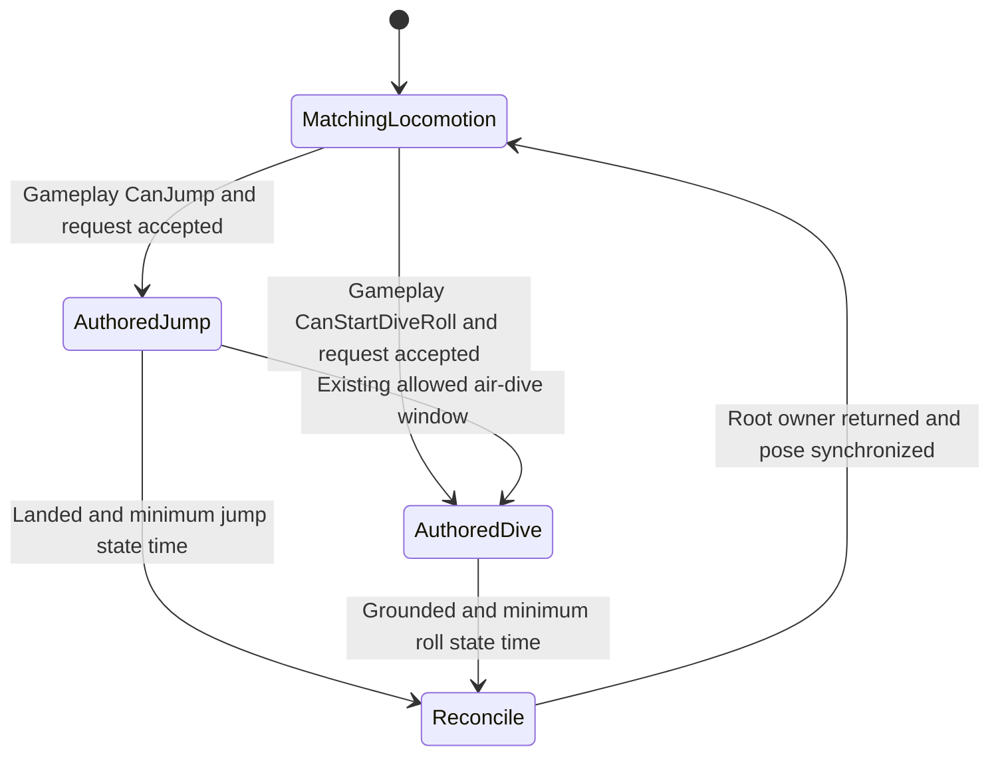

`Reconcile` is a proposed integration phase. It means update actual root pose/velocity, clear action ownership, refresh trajectory and pose history, blend to an appropriate matching continuation, and avoid replaying stale footstep/action events. It need not be a new MonoBehaviour or user-visible state.

### 14.6 Aim and rig preservation

Keep the target concept independent of animation backend. Equipment/aim state should supply camera mode, trajectory facing, rifle dataset filters, upper-body flags, spine weight, and weapon correction.

The final evaluation order must account for four concrete facts in this project: camera-centre target sampling, base pose evaluation, the pivot moving the weapon/grip, and IK consuming the grip target. A new matching PlayableGraph may need to feed the existing Animator/RigBuilder or host equivalent constraints in a supported graph. That compatibility is unknown until an implementation is selected and tested.

## 15. Component-by-component migration map

| Existing component/asset | Initial decision | Required adaptation / reason |
|---|---|---|
| `PlayerInputReader` and action asset | Keep | Add only required intents/bindings; preserve analog magnitude for speed. |
| `PlayerStateMachine` / `IPlayerState` | Keep | Continue action eligibility and ownership; avoid one gameplay state per matching clip. |
| `PlayerController` | Refactor in small steps | Separate motor/vertical simulation and equipment truth from animation details. |
| `PlayerLocomotionState` | Adapt | Produce intent/facing, call selected backend rather than directly owning all blend-tree inputs. |
| `PlayerJumpState` | Keep initially | Explicit authored-action and root handoff; preserve coyote/retrigger behavior. |
| `PlayerDiveRollState` | Keep initially | Preserve eligibility/action timing; isolate action delta from idle/ADS redirection. |
| `PlayerAnimator` | Split/adapt | Retain action/overlay helpers as needed; legacy grounded float writer becomes backend-specific. |
| `RootMotionRelay` | Replace or wrap deliberately | Route backend delta into sole motor; move gravity responsibility to an explicit schedule. |
| `PlayerController.controller` movement trees | Retain as fallback | Replace grounded selection in a controlled stage; do not discard action/overlay assets prematurely. |
| Rifle overlay / mask | Retain concept, validate | Ensure base matching pose and lower body are not overwritten unexpectedly. |
| `PlayerInteractionSystem` | Keep and adapt state output | Save authoritative equipment state; mirror rifle status to animation as presentation. |
| `WeaponPickupItem` / AR-15 prefab | Keep | Preserve socket/pivot/muzzle/grip chain on current or retargeted avatar. |
| `TPSCameraController` | Keep | Consume gameplay aim condition; validate rendered pose timing and device sensitivity. |
| `PlayerAimTargetProvider` | Keep | Choose a documented sampling phase and preserve self filtering. |
| `PlayerAimRigController` | Keep/adapt | Decide inactive spine-layer status; integrate with actual evaluation graph. |
| `WeaponAimAlignment` | Keep/adapt phase | Preserve rebasing; measure final muzzle error and hand interaction. |
| `PlayerLeftHandIK` | Keep concept, adapt schedule | Sample final intended grip before the corresponding hand solve. |
| Footstep receiver | Reuse playback | Feed backend contacts/events; preserve ground and duplicate guards intentionally. |
| Footstep reset behavior | Review | Currently unassigned; matching transitions may not call Animator state callbacks. |
| Legacy mouse/debug helpers | Leave outside main integration | They are not required for active shared targeting; cleanup is a separate decision. |

## 16. Phased implementation plan

This is a proposed implementation sequence, not a record of changes made during this reporting task.

### Phase 0: Capture a reproducible baseline

Record the intended current scene and preserve a reviewable asset/code snapshot, including the uncommitted camera/aim work. Compile in the configured Unity version, document existing Console errors, and record short movement/aim examples. Measure walk/sprint travel using capsule displacement; do not infer speed from `0.5`/`1` blend values.

**Exit condition:** current behavior and known exceptions are documented well enough to distinguish migration regressions from pre-existing problems.

### Phase 1: Make gameplay state independent of Animator state

Use equipment gameplay data as the source of rifle ownership and derive aim from equipment plus input and any chosen action policy. Mirror `HasRifle`/`isAiming` into the retained Animator graph. Decide whether jump/dive allow aim, and ensure camera, pose, and relay agree.

**Exit condition:** changing or disabling grounded animation selection does not change whether the player owns a rifle or is allowed to aim.

### Phase 2: Establish one motor/root contract using existing animation

Keep the current animation backend while making vertical simulation and displacement ownership explicit. Preserve controller dimensions, ground masks, jump/coyote values, carry damping, and action timers. Route existing root delta through the new boundary and confirm identical intended movement.

**Exit condition:** standing gravity works, stationary jump works, and no actor is moved twice. Horizontal locomotion and authored actions have named ownership.

### Phase 3: Select backend and prepare a small dataset

Evaluate the chosen implementation against Unity `6000.6.0f1`, Humanoid compatibility, root output, RigBuilder/PlayableGraph coexistence, action overrides, events/contacts, build target, and profiling visibility. Prepare/bake a coherent grounded subset for the current avatar.

No vendor is selected in this report. Exact APIs, compatibility, licensing, baking format, and installation steps depend on that choice and require separate verification.

**Exit condition:** database loads, selected pose/root delta can be inspected, and there is a repeatable bake process.

### Phase 4: Integrate unarmed grounded locomotion

Create intent from camera-relative move input and explicit speed/facing policy. Feed predictor from actual motor pose and velocity. Switch only grounded locomotion to the matching adapter while preserving a legacy fallback during development.

**Exit condition:** idle, start, walk/run, stop, diagonal travel, turns, reversals, and collision blocking behave consistently without root duplication or visible severe foot sliding.

### Phase 5: Restore authored jump and dive through handoff

Suspend matching playback/root ownership during authored actions. Preserve current eligibility windows. On landing/action completion, refresh root/velocity/trajectory and blend back from a compatible pose.

**Exit condition:** action entry/exit works from idle, movement, sprint, and edge cases without a positional jump or one-frame movement spike.

### Phase 6: Integrate rifle and ADS locomotion

Add rifle posture data/filters and separate facing from travel. Preserve free/aim camera handoffs and shared targeting. Validate overlay masking, spine-rig policy, final weapon correction, and hand rig integration with the selected graph.

**Exit condition:** aim strafe/backward motion remains correct; camera, torso, barrel, and off-hand agree during movement and transitions.

### Phase 7: Migrate footsteps and tune

Choose backend-supported clip events or contact-driven events. Verify duplicate suppression when frame search jumps or blends. Tune trajectory response, pose continuity, gait policies, and foot placement using the prepared dataset rather than compensating for missing content with arbitrary transforms.

**Exit condition:** footsteps correspond to contact, aim/collision motion remains stable, and CPU/memory behavior is measured on the intended target.

### Phase 8: Retire only proven fallback paths

Once parity is demonstrated, remove redundant legacy locomotion writers, obsolete graph branches, and outdated debug providers in a separately reviewable cleanup. Update architecture documentation to match the implemented backend and evaluation order.

**Exit condition:** one runtime animation/movement path is authoritative in each mode and the final project builds on the intended platform.

## 17. Verification and acceptance checklist

No items below were executed as runtime tests during this report. They are the validation plan for implementation.

### 17.1 Baseline and migration scenarios

| Scenario | Expected observation / evidence to capture |
|---|---|
| Idle for an extended period | No horizontal capsule drift; gravity/grounding continues. |
| Slow analog stick input | Desired speed responds as designed; direction normalization does not force full speed. |
| WASD and diagonals | Direction matches camera basis; diagonal travel is not unintentionally faster. |
| Walk/run/sprint transitions | Measured speed and selected gait agree; starts/stops do not snap. |
| Reverse input / sharp turn | Appropriate turn/stop selection; stable root/foot behavior. |
| Move into wall | Capsule blocks; actual velocity feedback reflects blockage. |
| Slopes, steps, ledges | Capsule/ground probe and trajectory remain coherent. |
| Walk off ledge | Gravity continues even with no horizontal animation delta. |
| Stationary and moving jump | Launch, carry, apex, ground ignore, and landing function. |
| Jump at edge | Coyote window preserved; no repeated held-button jump. |
| Ground roll from idle/movement | Action travels as intended despite low locomotion Speed. |
| Air dive before/inside/after window | Eligibility follows delay/window rules. |
| Release movement during action | No accidental loss of authored action displacement. |
| Rapid action return | No double root movement, stale trajectory, or replayed events. |
| Pickup nearest rifle | Physics disabled, correct pivot parent, equipment/animation flags agree. |
| Repeated Interact after equip | No duplicate attachment or ownership corruption. |
| ADS strafe/backward movement | Travel and facing are independent; S does not become forward travel. |
| RMB changes in jump/dive | Chosen gameplay aim policy matches camera, overlay, weapon, and rigs. |
| Camera aim/free handoffs | No sustained drift, axis discontinuity, or duplicated Look input. |
| Fast mouse movement | Check age of AimPoint and final barrel/reticle disagreement. |
| Near/far target and nearby cover | Inspect final muzzle ray; no claim of firing correctness until fire system exists. |
| Hand on rifle during fast turns | Grip target/IK tracks final weapon pose with acceptable lag. |
| Foot contacts and blends | Audible events align with contacts; no bursts or airborne steps. |
| Dense overlap/raycast scene | Buffer saturation does not silently violate expected target/pickup choice. |
| Disable/re-enable player | Input action lifecycle and backend initialization recover. |
| Target-platform build | Compilation, dependencies, database access, and graph support confirmed. |

### 17.2 Useful debug information

Expose input magnitude, requested velocity, actual displacement/velocity, desired facing, gameplay state, animation backend/action owner, grounded/coyote flags, vertical velocity, equipped weapon, computed aim, Animator aim bool, selected matching clip/frame/cost, and trajectory samples.

For aim debugging, inspect the rendered camera ray, shared world target, final muzzle forward, muzzle-to-target direction after correction, grip pose, hand target, and active rig-layer flags. Existing coloured rays help, but several debug producers can draw overlapping colours; identify the component that owns each ray.

Measure frame time, search/evaluation cost, database memory, allocations, and contact quality. Set acceptance budgets after identifying target hardware and design requirements; neither is specified by current repository evidence.

## 18. Practical wiring and debugging guide

### 18.1 Start with the component that owns the symptom

| Symptom | First inspection path |
|---|---|
| No input | Input action references/enabled state -> reader snapshot. |
| Correct animation, no travel | Relay enabled/config -> callback -> motor delta -> capsule collision. |
| No gravity after migration | Vertical simulation schedule -> old callback dependency -> single movement owner. |
| Unwanted idle movement | Animator `Speed` and root delta -> relay idle filter -> future matching contact/velocity policy. |
| Roll does not travel from idle | Action root delta -> locomotion Speed gate -> action ownership/filter scope. |
| Aim never enables | Actual equipment reference versus Animator `HasRifle` -> RMB snapshot -> computed condition. |
| Rifle faces wrong world point | Shared provider reference -> camera sampling phase -> final muzzle correction. |
| Torso does not react | RigBuilder spine-layer active flag -> rig/constraint weights -> source target/axes. |
| Left hand lags | Grip sampling phase -> late pivot correction -> hand rig evaluation phase. |
| Footsteps absent | Clip/contact event source -> receiver guards -> ground ray -> clips/AudioSource. |
| Footsteps duplicate | Multiple event sources -> matching jumps/blends -> cooldown/reset policy. |
| Rifle loses posture after matching | Equipment filters -> upper-body graph/mask -> rig compatibility. |

### 18.2 Existing Inspector reference checklist

On `PlayerRoot`, verify input references, controller's visual Animator wrapper, Main Camera transform, CheckPoint, Ground mask, interaction point/mask, camera controller cameras/axis controller/orbit component, shared provider Main Camera, spine controller provider/target/rig, and hand controller interaction/target/rig.

On the visual character, verify the assigned Humanoid Avatar/Animator controller, relay-to-controller reference, RigBuilder layers, constraint target/bones, and footstep audio/ground references. The relay must remain on the Animator GameObject if its callback remains the delta source.

On the weapon, verify root, muzzle, grip, physics hierarchy, layer, alignment component, and pickup-time configuration. The intended attach path is parent socket -> procedural pivot -> weapon; assigning player scene references directly into a reusable prefab is not necessary when runtime configuration is used correctly.

For the future backend, add database, trajectory, rig/Animator graph, root-motion output, action handoff, and event/contact checks. Keep those as explicit references or documented adapters rather than hidden Transform writes.

### 18.3 Recommended reading order in the repository

1. `PlayerInputReader.cs`: understand the input snapshot and bindings.
2. `PlayerStateId.cs`: understand state interfaces and transitions.
3. `PlayerLocomotionState.cs`: understand the current per-frame policy.
4. `PlayerController.cs`: trace guards, rotation, vertical motion, and capsule application.
5. `PlayerAnimator.cs` and `PlayerController.controller`: connect input values to graph selection.
6. `RootMotionRelay.cs`: close the animation-to-movement loop.
7. Jump/DiveRoll state files: understand action lifetimes and special movement.
8. Interaction/WeaponPickupItem: trace gameplay equipment ownership and attachment.
9. Camera/provider/rig/alignment/hand files: trace view, target, weapon, and pose relationships.
10. Footstep files and `.anim` event tails: understand presentation events before replacing the animation backend.

## 19. Evidence, limitations, and references

### 19.1 Primary repository evidence

| Evidence | What it establishes |
|---|---|
| [ProjectVersion.txt](ProjectSettings/ProjectVersion.txt) | Configured Editor version/revision. |
| [manifest.json](Packages/manifest.json), [packages-lock.json](Packages/packages-lock.json) | Declared and locked package versions/sources. |
| [EditorBuildSettings.asset](ProjectSettings/EditorBuildSettings.asset) | One enabled scene and registered input action asset. |
| [GraphicsSettings.asset](ProjectSettings/GraphicsSettings.asset), [PC_RPAsset.asset](Assets/Settings/PC_RPAsset.asset) and metadata | Assigned URP asset relationship. |
| [ProjectSettings.asset](ProjectSettings/ProjectSettings.asset), [TagManager.asset](ProjectSettings/TagManager.asset) | Input handler and layer indices. |
| [Test.unity](Assets/Scenes/Test.unity) | Components, serialized references, overrides, hierarchy, Animator, constraints, rig active flags, scene values. |
| [AR-15 prefab](Assets/Prefabs/Gun/ar15.prefab) | Pickup root, muzzle/grip, physics, alignment defaults, disabled legacy debug. |
| [Animator controller](Assets/Scripts/Player/Animation/PlayerController.controller) | Parameters, layers, states, transitions, blend-tree samples, playback speeds. |
| [RifleUpperBodyMask.mask](Assets/Scripts/Player/Animation/RifleUpperBodyMask.mask) | Humanoid and transform masking configuration. |
| [Input actions](Assets/InputSystem_Actions.inputactions) | Player/UI action maps and actual bindings. |
| [Character importer metadata](Assets/Prefabs/Chracter/Ch15_nonPBR.fbx.meta) | Humanoid importer setting. |
| All 19 first-party `.cs` files linked in Section 5 | Runtime method behavior, guards, dependencies, scheduling attributes. |
| Animation `.anim` files and animation metadata | Clip references, authored event presence, candidate data inventory. |
| [Earlier architecture](docs/ARCHITECTURE.md), [earlier aiming report](docs/newArch.md) | Historical context, checked against current implementation. |
| Git log/status and current HEAD | Committed milestone versus current in-progress snapshot. |

Useful search anchors inside `Test.unity` are `PlayerRoot`, `PlayerInteractionSystem`, `PlayerAimTargetProvider`, `WeaponAimPivot`, `RigBuilder`, `m_RigLayers`, and `m_Active`. Inside the Animator controller use `m_AnimatorParameters`, `m_AnimatorLayers`, `m_Childs`, `m_Conditions`, and `m_StateMachineBehaviours`.

### 19.2 External primary references

- [Unity: OnAnimatorMove](https://docs.unity.com/en-us/engine/6000.0/script-reference/unityengine/monobehaviour/onanimatormove): animation callback ordering. The linked page documents Unity 6.0; current local project version is recorded separately above.
- [Ubisoft La Forge: Introducing Learned Motion Matching](https://www.ubisoft.com/en-us/studio/laforge/news/6xXL85Q3bF2vEj76xmnmIu/introducing-learned-motion-matching): explanation of the underlying motion matching concept and its data requirements.
- [Ubisoft La Forge: Learned Motion Matching](https://www.ubisoft.com/en-us/studio/laforge/news/3NWqwcMU9lMfumgfPAEfka/learned-motion-matching): research context distinguishing a learned alternative from conventional motion matching.

The proposed roles, migration phases, contracts, and acceptance cases are engineering recommendations inferred from this project's code and configuration. They are not documentation for an installed motion matching package.

### 19.3 Explicit limits and open decisions

- Live Unity connection was unavailable; no claim is made that the current project compiles, runs without Console errors, or visually matches intended behavior.
- Serialized scene configuration was inspected without opening/saving scenes. Unsaved Editor changes are outside this snapshot.
- No player build, automated tests, asset reimport, package change, or profiling session was run.
- No first-party tests, custom assemblies, CI workflow, or runtime networking implementation were found in the inspected project files.
- Animation samples were mapped by serialized references/metadata; all imported clips were not visually reviewed or motion-database baked.
- No target platform/hardware, memory budget, responsiveness budget, selected matching implementation, or final dataset policy was supplied. These remain implementation decisions.
- There is no firing system to validate; aim geometry and weapon alignment should not be reported as verified hit accuracy.
- Diagrams are embedded as editable Mermaid source. Use a Markdown preview with Mermaid support to render them; source remains readable in other editors. The diagrams were structurally reviewed, but an actual Mermaid renderer was not available locally during authoring.
- This report is the requested root-level architecture artifact. No separate onboarding/health document was created, and the existing documentation and in-progress project edits were preserved.

