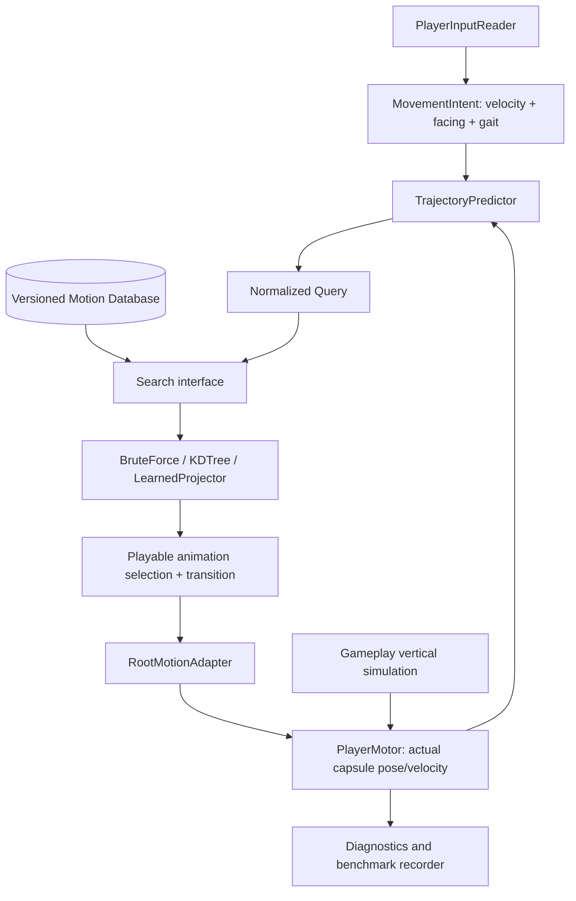

# Motion Matching Architecture

**Cleanup update (2026-11-24):** The original Test scene, rifle prefab, broken Ch15 variant, stale recovery scenes and nine LegacyShooter scripts have been retired. MotionMatchingTest is the sole enabled build scene; Runtime references Core, Input System and Cinemachine. Earlier preservation/legacy-retention statements below describe the M1/C1 baseline. Fresh cleanup validation and remaining publication limits are in [FINAL_CLEANUP_REPORT.md](migration/FINAL_CLEANUP_REPORT.md).

**Project goal:** a portfolio-grade, fully playable third-person character whose grounded locomotion uses motion matching. Papers and external implementations inform engineering choices; the deliverable is movement that feels and looks natural in play. Judge the system by responsiveness, starts/stops, acceleration, turns and pivots, pose continuity, minimal foot sliding, collision behavior, and measured runtime cost.

**M2/M3 status (2026-11-25):** the nine-clip M2 database is baked, reloaded and visually inspected. M3A/M3B provide Core prediction/query/search; opt-in M3C now connects live character features and selected clips through Playables. The user-authorized experimental matching component is enabled and saved in MotionMatchingTest; the M2.5 broader-coverage gate and M3 playable exit remain open. The exact data contract is [FEATURE_SCHEMA.md](data/FEATURE_SCHEMA.md), M2 evidence is in [M2_IMPLEMENTATION_REPORT.md](migration/M2_IMPLEMENTATION_REPORT.md), and current validation is in [PROGRESS.md](PROGRESS.md). Historical architecture is in `Report.md`.

Current source/scene evidence and the staged migration plan are in `migration/REPOSITORY_ASSESSMENT.md`. Gravity advances without root callbacks. MotionMatchingTest uses the dedicated unarmed controller; opt-in matching retains it for authored actions and fallback locomotion.

## Implemented assembly boundaries

All project-owned C# source is consolidated beneath `Assets/Scripts/MotionMatching/`. No asmdef at `Assets/` or `Assets/Scripts/` captures third-party code. Existing script, folder and assembly metadata moves with its assets; class namespaces and serialized type identities are retained.

| Assembly / folder | References | Compilation boundary |
|---|---|---|
| `MotionMatching.Core` / `Core` | No project or engine assemblies | Root accumulation, motion DTOs/math, 27D features, normalization and portable binary data; `noEngineReferences: true`. |
| `MotionMatching.Runtime` / `Runtime` | Core, Unity.InputSystem, Unity.Cinemachine | Existing gameplay plus the MotionDatabaseAsset wrapper. LegacyShooter was retired in C2; Rigging is no longer a Runtime assembly reference. |
| `MotionMatching.Editor` / `Editor` | Core, Runtime, Unity.InputSystem, Unity.Cinemachine | Assembly audit/capture harness plus isolated Humanoid sampler and database baker/debugger. |
| `MotionMatching.Tests.Editor` / `Tests/EditMode` | Core, Runtime, Editor, Unity test assemblies | Editor-only NUnit/test-runner references. |
| `MotionMatching.Tests.Runtime` / `Tests/PlayMode` | Core, Runtime, runtime test assemblies | Play Mode tests; no Editor reference; excluded from ordinary players. |

Dependency arrows mean references: `Runtime -> Core`; `Editor -> Runtime, Core`; test assemblies depend on production assemblies. Core and Runtime never reference Editor or tests. Tests retain `autoReferenced: false`, `UNITY_INCLUDE_TESTS` and explicit NUnit/test-runner references. No Neural assembly or placeholder package exists.

Character gameplay, input and state types now compile in Runtime with the motor rather than predefined Assembly-CSharp. Their compiled assembly identity intentionally changes; class names, namespaces and MonoScript GUIDs stay unchanged. No project SerializeReference payloads were found. Preserved scenes retain their old diagnostic class-identifier strings; actual component resolution must be verified in Unity. Editor tooling compiles in the named Editor assembly. Regression tests reference production types directly; reflection remains only for private fixture fields.

During C1, `Runtime/LegacyShooter` retained dependencies serialized by the original Test scene, AR-15 prefab and recovery scene. C2 retired those obsolete consumers and compatibility scripts after a reference audit. The historical dependency map is [CONSOLIDATION_AUDIT.md](migration/CONSOLIDATION_AUDIT.md); the final removal inventory is in the cleanup report.

The earlier M1 run passed seven EditMode and six PlayMode tests. Those results establish the pre-consolidation baseline only; fresh consolidation results belong in [PROGRESS.md](PROGRESS.md).

## Implemented motor schedule

`PlayerController` constructs a plain C# `MotionMatching.Runtime.CharacterMotor` around its existing CharacterController. Existing serialized gameplay parameters, scene values and animation graph are preserved; no extra scene component or configuration asset is required.

1. Normal-mode animation evaluates. `RootMotionRelay.OnAnimatorMove()` retains horizontal filtering and optional yaw behavior, then calls `PlayerController.ApplyRootMotionMovement()` to submit horizontal world-space metres. The configurable `rootMotionActionTag` defaults to `RootMotionAction`; a matching current or next base-layer state bypasses the Speed idle filter. Only Dive Roll has that tag in the dedicated unarmed controller. Submission performs no gravity integration or capsule movement.
2. The first operation in `PlayerController.LateUpdate()` is `SimulateMotor()`. Gameplay integrates gravity, prepares vertical and jump-carry displacement, and calls `CharacterMotor.Step()` independently of callback availability.
3. `RootMotionAccumulator` sums XZ submissions for the current rendered frame and consumes them once. The motor rejects repeated same-frame steps and submissions after a step; missing callbacks cannot replay previous-frame travel. Disabled controller/capsule paths clear pending motion.
4. The motor makes the sole first-party `CharacterController.Move` call, combines animation XZ with gameplay displacement, and exposes collision-resolved `ActualVelocity` and `CollisionFlags`. Gameplay then applies existing carry damping and performs its existing ground-ignore, grounding, coyote and input-lock updates.

Gameplay retains gravity/jump parameters, vertical velocity, carry and action guards. The motor owns capsule displacement, buffering and measured output. Existing states retain yaw authority by default. Opt-in matching uses Normal Animator evaluation with an automatic GameTime graph before the same LateUpdate motor step; fixed/manual gameplay evaluation requires separate scheduling and validation. The relay bypasses the legacy idle-speed filter for matching and discards translation/rotation once after a matching seek or activation. Experimental root yaw suppresses scripted grounded yaw while matching owns it.

M1 baseline Unity evidence: seven EditMode tests passed in `.utmp/m1-final/editmode-results.json`; six PlayMode tests passed in `.utmp/m1-final/playmode-completed.json`. Two callback-free gravity/jump regressions failed against the earlier implementation (`.utmp/m0-baseline/legacy-motor-before-results.json`) and passed after decoupling. Coverage includes consume-once/stale-delta handling, disabled capsule, wall collision, callback-free fall/jump/apex/landing, imported assemblies and dedicated scene/controller references. Full slope/ledge/coyote-boundary/contact-quality acceptance remains separate.

The earlier motor comparison observed stable speed changes below 0.5%, approximately 1.33 m jump ascent, camera offset below 0.8 mm and no measured idle drift. Final post-detachment confirmation is `.utmp/m1-final/locomotion-confirm.txt`, with metrics in `locomotion-confirm-analysis.json`: 1,140 consecutive 60 Hz samples over approximately 19 seconds, successful completion/restoration and no sample errors. Stable walk/sprint/turn speeds were 1.626/5.524/1.673 m/s; jump ascent/carry were 1.32998/1.60444 m; dive travel was 3.27525 m compared with the earlier zero-travel defect. Idle/post-dive drift were zero. Traversal geometry changed during detachment, preventing identical whole-route comparisons.

## Dedicated unarmed scene — historical M1 evidence

Live Editor edits reduced MotionMatchingTest from 102 to 82 GameObjects, with seven roots retained. Removed pickup/table/AR-15 content, interaction sphere component and InteractionPoint, ADS camera/target, weaponSocket/pivot, hand/spine rigs and RigTargets, five shooter components on PlayerRoot, and RigBuilder. BoneRenderer debug visualization remains. The original Test scene, controller, animation clips and existing GUIDs were preserved.

The scene now uses `Assets/Animations/MotionMatching/UnarmedLocomotion.controller`, a separate copy with rifle graph/subassets removed. It has one layer and three states: Locomotion, Jump and Dive Roll. Rifle/aim bool parameters remain for compatibility with the retained `PlayerAnimator` facade; they no longer select rifle graph branches in this controller. Original shooter source remains available for the original scene.

TPSCamera retains its free Cinemachine behavior and CameraTarget reference. `FreeCameraLookInput` binds Look Orbit X/Y to `Player/Look` from the same input asset, leaves action enabling to the existing player reader, and releases its temporary action reference on destruction. Confirmed Look input changed orbit by 58.7254 degrees and actual camera orientation by 58.7255 degrees. A rendered screenshot showed unarmed walking. Final Editor inspection found a clean MotionMatchingTest, 82 objects/seven roots, compilation failure false and zero current Console errors; five historical corrected-tooling errors remain separately recorded. Directory ownership is in `migration/DIRECTORY_LAYOUT.md`.

## 1. Ownership contracts

The following flow describes the ownership design. The motor, database, prediction, query/search and opt-in Playables path exist; learned projection and broader diagnostics remain future work.

- Input **requests**, search **selects**, animation **provides a pose/root delta**, motor **resolves real movement**.
- One owner of `CharacterController.Move`; gravity integrated once per simulation step, including when root horizontal delta is zero.
- One yaw owner chosen per mode; no double application of `Animator.deltaRotation` and scripted yaw.
- Motion query is based on **actual, collision-resolved** movement plus future desired travel.
- Camera-relative **desired velocity** and **desired facing** are separate values. Never infer desired gait from a normalized direction alone.
- Authored actions, if retained, suspend grounded matching via an explicit action owner; on exit reconcile trajectory/history and root state.

## M3A/M3B trajectory and search contract

`MotionTrajectoryPredictor` is a pure Core function. It receives camera forward/right, input axes, collision-resolved velocity, current facing and explicit desired-facing yaw separately, plus speed/acceleration/turn-rate settings and three horizons. It integrates deterministically in bounded steps, independently initializing each horizon from the same sampled collision-resolved velocity, and returns 12 raw trajectory values: three local ground-plane positions and three sine/cosine facing pairs. `MotionTrajectoryQuery` is the Unity-facing Runtime adapter: it reads the character/camera transforms and supplied input, collision-resolved velocity and desired-facing direction, then calls the Core predictor; it does not move or rotate scene objects. `MotionQueryBuilder` combines prediction with a baked row's 15 pose features for offline queries; the M3C controller supplies live pose features separately.

`BruteForceMotionSearch` is the exact reference. `KdTreeMotionSearch` builds a balanced cyclic-split 27D tree over valid rows, applying the same database normalization and five nonnegative feature-group weights. The index copies its weights at construction. Both return global row, clip index, local frame, sample time, total cost and per-group costs; exact ties select the lowest global row. Search eligibility is `ValidFrames` only. M3C now supplies `MotionSearchContext`: a nonnegative switch penalty participates in complete candidate cost inside both searches, with natural continuation unpenalized and circular loop phase distance. Runtime reselection additionally enforces improvement/spacing/interruption policy; no tag eligibility filter is implied.

The Editor Baker exposes five group weights and selected-row query diagnostics. This visualizes a query built from baked data; it is explicitly not a live input/trajectory diagnostic. Benchmark evidence and limits are recorded in [PROGRESS.md](PROGRESS.md).

## M3C opt-in playback contract

**2026-11-25 hardening in progress:** MotionMatchingTest now selects the 25-clip `HumanBasicMotions60.asset` (1,276 searchable rows, 60 Hz, unchanged 27D/schema-v1 contract); the original nine-clip asset remains `PreviousDatabase` for rollback. Seek/root-continuity hardening has focused old-database capture evidence. Root extraction now accounts for Avatar-local velocity and Humanoid scale before the world-space motor handoff; the stronger yaw/60–120 Hz fixture improved from 5/11 to 11/11. Intent springs and complete-cost search penalties are implemented, with focused math 14/14 and selection/spring 4/4. Experimental inertialization remains disabled after an 8/9 run with a failing interrupted 60 Hz Humanoid pose-continuity gate; crossfade is default. All-31 audit/export, rebake, current benchmark, full tests and final capture remain pending. See [M3C_HARDENING_REPORT.md](migration/M3C_HARDENING_REPORT.md) for inventory, settings and evidence boundaries.

`MotionMatchingController` requires the retained player/animation facade, valid matching Humanoid Avatar, complete source clips with matching duration/loop imports, and finite playback settings. It builds a KD-tree and one copied weight snapshot used by the optional brute-force oracle and continuation cost. The playback asset uses trajectory-position/facing, joint-position/velocity and pelvis-velocity weights `10, 2, 1, 0.25, 0.25`; equal weights caused an observed idle-selection lock under forward intent. Runtime weight edits validate/copy the new weights and rebuild the index, keeping the oracle and continuation metric consistent.

During grounded matching, Update spring-smooths camera-relative desired horizontal velocity and facing (default half-lives 0.06 s each), then predicts from collision-resolved velocity and smoothed intent. Live queries use current root-local foot positions plus the latest world foot/pelvis velocities rotated into current root yaw. LateUpdate samples world bone positions every rendered frame after animation and the motor step, avoiding differentiation across search intervals. It also captures the actual displayed pose read-only for experimental inertialization history; no Transform writes are introduced. Search runs at the configured interval; a continuation window and complete-cost penalty plus absolute/relative improvement, switch spacing and intent interruption policy limit reselection. Nonlooping clips complete their full authored duration before another search selection, including stored but unsearchable tails. Action ownership suspends matching and resets pose/intent history.

`MotionPlayablePlayer` owns one automatic GameTime graph/output. Its root mixer selects the retained `AnimatorControllerPlayable` or a two-slot matched-clip mixer; the controller remains available for authored actions/fallback and its grounded-matching branch weight is zero. Matched clips seek to the selected source time, crossfade, and use native imported looping. Interrupted crossfades retain the heavier outgoing slot. Experimental inertialization is disabled in the scene: requested bone rotations do not guarantee exact final Humanoid rotations, and the current 60 Hz interrupted continuity result is 0.677239239 degrees against a 0.1-degree gate. The failed two-output PreviousInputs experiment was reverted; future inertialization requires a Humanoid-compatible pose contract and final displayed-pose/velocity validation. The player never moves the capsule; the relay delivers approved horizontal root deltas to the existing motor schedule. Input yaw remains default (`ApplyRootYaw=false`); clip root yaw is experimental.

Disable/disposal destroys the graph and restores the original controller/root-motion setting and readable parameters. Active Animator handoff also restores each layer's current state/time; inactive rigs restore controller/settings/parameters without animation-state restoration, avoiding Animator.Play on an inactive object; later action-state resumption is not guaranteed. Pending triggers and in-flight controller transition blends cannot be reconstructed. Opt-in implementation and focused test results do not establish complete playable acceptance, perceptual transition quality, allocation behavior or Player performance; current evidence and open gates are in [PROGRESS.md](PROGRESS.md).

## Future interface seams

- `IMotionFeatureProvider`: make versioned query and sampled candidate feature vectors.
- `IMotionSearch`: `FindBest(query, eligibilityFilter)` yields candidate frame, cost and diagnostics. A search result is **not** an animation pose.
- `IMotionDatabase`: immutable view of feature rows, animation clip/frame mapping, normalization metadata, tags and versions.
- `IMotionPlayback`: seek selected clip/time; blend/inertialize; report consistent root delta.
- `ICharacterMotor`: apply approved horizontal delta + gameplay vertical movement, resolve collision, expose actual velocity/grounding.
- `IMotionMetrics`: capture search ms, total frame ms, database RAM, transitions, contact sliding and allocations.

Prefer serialized config assets or versioned database metadata over hard-coded values; dependency injection can be manual/Inspector-driven rather than a new DI framework.

## 3. Database pipeline — offline

M2 implements this pipeline through `MotionAnimationSampler`, `MotionDatabaseBuilder`, `MotionDatabaseBinary`, `MotionDatabaseAsset` and `MotionDatabaseBakerWindow`. Use **Tools > Motion Matching > Motion Database Baker**. Select the persistent character model and its bound Humanoid Avatar; select clips/tags/loop policies, frequency and horizons; bake, save and reload. The window plots root paths and sampled joint velocities without creating gameplay scene objects.

The original dataset is `Assets/Animations/MotionMatching/Databases/LocomotionBaseline.asset`. As of 2026-11-24 it contains nine clips at 60 Hz: the initial Idle/walk/run/strafe subset plus backward walk/run and left/right 180-degree turns. The asset holds 1,026 rows, 906 searchable; non-looping turn tails are excluded because the one-second future horizon exceeds clip bounds. Each row retains the 27 matching values plus roots, joint data and 52 mapped Humanoid parent-local bone transforms. The 2026-11-25 hardening increment assigns `HumanBasicMotions60.asset` for live matching and preserves this baseline as rollback; the new 25-clip inventory and its contact/coverage limits are in the [hardening report](migration/M3C_HARDENING_REPORT.md). Preserve this common raw data for both classical search and later neural export. M2 does not define neural targets or a training partition; fit future training normalization only on training sequences. Current source coverage and bake evidence are in [PROGRESS.md](PROGRESS.md).

M2.5 extends the Editor baker with **Motion Database Health** and an isolated mesh/skeleton/both 3D viewport. Source evaluation caches the full hierarchy once per selected clip; stored-pose inspection restores the reference hierarchy and applies saved mapped local poses/root transforms. No gameplay scene object drives this preview. Health thresholds warn without filtering rows or discarding clips. Evaluated/stored world-pose comparison and independent AnimatorController mapped-local/root parity serve different checks. On 2026-11-24, a preview jitter fix addressed whole-frame stepping at 60 Hz for moving clips and root reset at loop boundaries: an elapsed-time Editor clock drives deterministic interpolation between cached source or stored poses, while loop root placement composes an accumulated rigid cycle transform. `OnGUI` only renders and does not advance the clock. Unity EditMode coverage passed 64/64, including subframe stability, loop continuity and nonloop clamping across moving saved-database clips. Manual before/after captures confirmed playback-time advancement and wrapping, but still captures and automated transform checks do not establish perceived smoothness throughout continuous rendered playback. See [PROGRESS.md](PROGRESS.md) for this validation evidence and the [M2.5 report](migration/M25_IMPLEMENTATION_REPORT.md) for prior usage and coverage results. The M2.5 preview change itself left Core/Runtime, the five assemblies and binary/schema v1 unchanged. The [consumer contract](data/FEATURE_SCHEMA.md#m25-consumer-contract-and-inspection) specifies immutable consumer treatment of mutable arrays, valid-row mapping and the proposed M3 weighted distance; M3A/M3B implement prediction/query construction and search; the opt-in M3C playback contract above describes live consumption, with acceptance still open.

Sampling reads the root Transform after Unity evaluates root motion in an isolated manual graph; it does not use Hips translation as the root. Independent AnimatorController/Animator.Update evaluation verifies root position and rotation. Root/joint raw samples are rebased to the first evaluated root; matching uses current-root yaw with X right/Y up/Z forward. Joint velocities differentiate sampling-frame positions before rotating, preserving the motion of planted feet. Root angular rates retain all three axes.

Loops exclude a duplicate terminal row and retain an exact root endpoint. Cycle continuation composes root translation/yaw, with central derivatives across the seam; loop durations must align to the grid. Nonloop tail rows without all horizons remain stored but unsearchable. Positions, velocities, quaternions and dimensions must be finite/valid. Normalization uses valid rows only and retains actual means/stds plus the epsilon-clamped scales. Contact flags are unverified per-clip height/speed heuristics.

Binary format/schema are both v1. Packed float32 arrays, source GUID/local IDs, tags, frame offsets, source/import/Avatar hashes and original local poses survive binary and Unity-asset reload. Source identity/hash validation prevents reassociating old data with changed clips. See the schema for exact offsets, serialization and boundary limitations. The numbered outline below retains the overall design sequence.

1. Create a vetted clip manifest: source GUID/path, source hash, Humanoid avatar, import settings, frame rate, tags, loop boundaries, gait/facing coverage.
2. Sample the pose **and source root motion**, verifying Unity Humanoid root projection/import settings. Hips transform movement alone is not an authoritative substitute for root delta.
3. Sample feet and pelvis at fixed times (initially 60 Hz), compute finite-difference linear velocities. Convert to consistent X-right/Y-up/Z-forward character-local coordinates.
4. Sample future root trajectory at offsets 20, 40, 60 frames (at 60 Hz); store 2D local position and facing in the horizontal plane.
5. Compute dataset mean/standard deviation from **training data only** and store them in the database, alongside weighting and schema identifiers. Prevent division by zero for constant dimensions.
6. Mark valid frame indices (future horizon available; stop/loop/clip-tag restrictions); never wrap an unlooped end into a fake trajectory.
7. Bake rows and verify by reloading, inspecting root curves, visualizing foot trajectories, and checking deterministic hashes.

### 27-dimensional locomotion baseline from Holden et al. (2020)

| Features | Dimensions |
|---|---:|
| Future ground-plane positions (3 x X,Z) | 6 |
| Future ground-plane facing directions (3 x X,Z) | 6 |
| Two foot local positions (2 x XYZ) | 6 |
| Two foot local velocities (2 x XYZ) | 6 |
| Pelvis local velocity (XYZ) | 3 |
| **Total** | **27** |

This is the paper's **locomotion example**, not a universal contract. Gait can be handled by eligibility filtering/tags or additional encoded features. Foot contact information belongs in auxiliary metadata/output unless the schema deliberately includes it.

## 4. Search backends

**Implemented correctness reference — brute force**: iterate valid rows and evaluate weighted normalized squared distance using database means/scales plus the supplied nonnegative continuation/switch penalty, with deterministic lowest-global-row tie breaking. It is the result oracle for the KD-tree under the same context and weights; final runtime reselection gates remain separate.

**Implemented primary backend — cyclic-split KD-tree**: the balanced 27D tree indexes only `ValidFrames`, with each normalized coordinate multiplied by the square root of its group weight so pruning and exact cost use the same metric. It copies the configured five weights. Exact results matched brute force on the saved 906-row database under the validated query set. The local Editor benchmark measured 4.7/7.5 microseconds KD p50/p95 versus 148.9/213.4 microseconds brute-force p50/p95; build time was 2.0743 ms and node payload 14,496 bytes, excluding array header. These are Editor-only measurements and include Stopwatch overhead; they do not establish Player performance or allocation behavior. See [PROGRESS.md](PROGRESS.md).

Current search eligibility has no tag, action, clip-continuation or transition filter. The 39 searchable rows per non-looping turn are indexed, but safe selected-clip playback through their ends is not implemented. Database weights remain separate from stored normalization and are applied identically to the oracle and index.

**Later MLP/ANN experiment**: define the prediction target before training, such as a matching feature representation or candidate selection, and compare with the classical system. Do **not** regress raw frame indices as if adjacent IDs mean similar motion. If the network predicts a feature vector, define how it maps to a playable frame, e.g. nearest feasible database candidate; this **still uses a database**. Record agreement, feature-distance error, gameplay motion quality and runtime.

**Unity Sentis/Inference Engine**: export ONNX plus normalization schema/version and expected tensor shapes. Validate output parity with Python, runtime backends, model lifetime and tensor disposal. Preserve the classical fallback. The inference package is `com.unity.ai.inference`, documented APIs in recent 2.6 versions use `Unity.InferenceEngine`.

**Optional fuller learned system**: learned Projector + Stepper + Compressor/Decompressor components may be explored after the playable classical system and portfolio demo goals are met. A projector-only MLP is not full Learned Motion Matching, and implementing the full paper is not required for project success.

**Gameplay evaluation:** run both matching modes on the same animation database and input scenarios. Record perceived responsiveness and transition continuity alongside 90°/180° changes, starts/stops, contact sliding, collision behavior, frame-time distribution and memory. A correct search result alone does not establish successful locomotion.

## 5. Transition and movement details

- Continue current clip normally between searches; search at a configurable cadence or when intent changes significantly.
- Change selection only when candidate improves cost sufficiently; a cooldown/hysteresis alone is not pose continuity. Test inertialization separately.
- Track clips and frame/time offsets explicitly. Prevent replaying footstep events when seeking/switching.
- Do not add root delta directly to `transform.position` while also calling `CharacterController.Move`.
- Keep jump/dive as authored actions until the grounded motor/search is stable; authored actions must bypass idle root filtering.

## 6. Repository integration map

| Current first-party component | New responsibility |
|---|---|
| `PlayerInputReader` | Remains intent source; preserve analog magnitude |
| `PlayerController` | Now schedules gravity/carry and motor in LateUpdate; retains grounding and gameplay action guards |
| `CharacterMotor` | Now owns capsule Move, frame-local root buffering and collision-resolved output |
| `PlayerLocomotionState` | Still writes legacy blend parameters; future matching mode will produce intent |
| `PlayerAnimator` | Transitional action facade; retire old grounded blend writers after parity |
| `RootMotionRelay` | Now submits legacy horizontal deltas without moving capsule/integrating gravity; future matching root source remains planned |
| `PlayerJumpState`, `PlayerDiveRollState` | Optional authored actions with exclusive owner |
| Weapon/ADS/IK scripts | Detached from MotionMatchingTest; retained for original scene/source preservation |
| `FreeCameraLookInput` | Binds retained free-camera axes to the existing Look action |
| Dedicated unarmed Animator controller | Retains grounded blend tree and authored actions; matching playback remains future work |

## 7. Validations

- **Data**: missing bones; mismatched scale; zero-std features; non-finite numbers; invalid loop boundary; wrong horizon; 60 Hz vs import rate; order of XYZ/XZ.
- **Search**: exact brute-force oracle vs KD-tree, filters, duplicate feature rows, ties, weights and query normalization.
- **Motor**: idle drift, wall stop, ledges, slopes, stationary jump, gravity without root callbacks, no double root.
- **Visual**: foot skate/contact, repeated transitions, 180-degree turns, abrupt reversing, trajectory debug overlay.
- **Performance**: dataset and schema hash, frame count, CPU, device, p50/p95/p99 query time, allocations, memory.

## Primary research

- Simon Clavet, GDC 2016 (slides): https://ubm-twvideo01.s3.amazonaws.com/o1/vault/gdc2016/Presentations/Clavet_Simon_MotionMatching.pdf
- Holden, Kanoun, Perepichka, Popa, *Learned Motion Matching*, ACM TOG 2020: https://doi.org/10.1145/3386569.3392440
