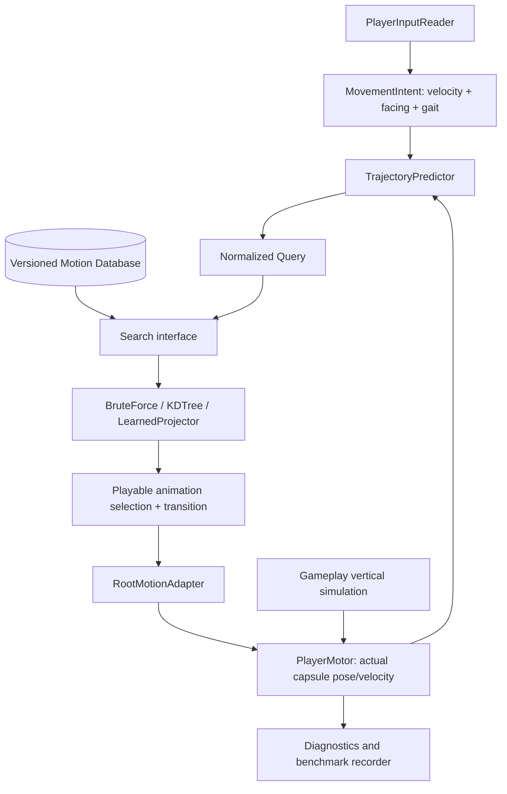

# Motion Matching Architecture

**Status:** the motor boundary and five assemblies are implemented and covered by Unity tests. Feature extraction, search, matching playback and neural stages below remain proposed. Historical architecture is in `Report.md`.

Current source/scene evidence and the staged migration plan are in `migration/REPOSITORY_ASSESSMENT.md`. Gravity now advances without root callbacks. MotionMatchingTest has been detached from shooter/ADS systems and uses a dedicated unarmed controller, with passing post-detachment Unity tests and confirmed action/camera capture. Grounded playback and authored actions still use the legacy Animator approach.

## Implemented assembly boundaries

All project-owned C# source is consolidated beneath `Assets/Scripts/MotionMatching/`. No asmdef at `Assets/` or `Assets/Scripts/` captures third-party code. Existing script, folder and assembly metadata moves with its assets; class namespaces and serialized type identities are retained.

| Assembly / folder | References | Compilation boundary |
|---|---|---|
| `MotionMatching.Core` / `Core` | No project or engine assemblies | Pure C# root accumulation; `noEngineReferences: true`. |
| `MotionMatching.Runtime` / `Runtime` | Core, Unity.InputSystem, Unity.Cinemachine, Unity.Animation.Rigging | Input, character, motor, states, animation, free camera, and retained original-scene compatibility. Rigging is required by referenced legacy scripts. |
| `MotionMatching.Editor` / `Editor` | Core, Runtime, Unity.InputSystem, Unity.Cinemachine | Editor-only assembly audit and migration capture harness. Sampling/baking remain future work. |
| `MotionMatching.Tests.Editor` / `Tests/EditMode` | Core, Runtime, Editor, Unity test assemblies | Editor-only NUnit/test-runner references. |
| `MotionMatching.Tests.Runtime` / `Tests/PlayMode` | Core, Runtime, runtime test assemblies | Play Mode tests; no Editor reference; excluded from ordinary players. |

Dependency arrows mean references: `Runtime -> Core`; `Editor -> Runtime, Core`; test assemblies depend on production assemblies. Core and Runtime never reference Editor or tests. Tests retain `autoReferenced: false`, `UNITY_INCLUDE_TESTS` and explicit NUnit/test-runner references. No Neural assembly or placeholder package exists.

Character gameplay, input and state types now compile in Runtime with the motor rather than predefined Assembly-CSharp. Their compiled assembly identity intentionally changes; class names, namespaces and MonoScript GUIDs stay unchanged. No project SerializeReference payloads were found. Preserved scenes retain their old diagnostic class-identifier strings; actual component resolution must be verified in Unity. Editor tooling compiles in the named Editor assembly. Regression tests reference production types directly; reflection remains only for private fixture fields.

`Runtime/LegacyShooter` holds dependencies still serialized by the preserved original Test scene, AR-15 prefab and recovery scene. They are absent from MotionMatchingTest. Keeping this compatibility code preserves those assets; it does not add another movement motor or animation playback backend. Deletion requires a later explicit decision to retire all referring assets. The dependency audit is [CONSOLIDATION_AUDIT.md](migration/CONSOLIDATION_AUDIT.md).

The earlier M1 run passed seven EditMode and six PlayMode tests. Those results establish the pre-consolidation baseline only; fresh consolidation results belong in [PROGRESS.md](PROGRESS.md).

## Implemented motor schedule

`PlayerController` constructs a plain C# `MotionMatching.Runtime.CharacterMotor` around its existing CharacterController. Existing serialized gameplay parameters, scene values and animation graph are preserved; no extra scene component or configuration asset is required.

1. Normal-mode animation evaluates. `RootMotionRelay.OnAnimatorMove()` retains horizontal filtering and optional yaw behavior, then calls `PlayerController.ApplyRootMotionMovement()` to submit horizontal world-space metres. The configurable `rootMotionActionTag` defaults to `RootMotionAction`; a matching current or next base-layer state bypasses the Speed idle filter. Only Dive Roll has that tag in the dedicated unarmed controller. Submission performs no gravity integration or capsule movement.
2. The first operation in `PlayerController.LateUpdate()` is `SimulateMotor()`. Gameplay integrates gravity, prepares vertical and jump-carry displacement, and calls `CharacterMotor.Step()` independently of callback availability.
3. `RootMotionAccumulator` sums XZ submissions for the current rendered frame and consumes them once. The motor rejects repeated same-frame steps and submissions after a step; missing callbacks cannot replay previous-frame travel. Disabled controller/capsule paths clear pending motion.
4. The motor makes the sole first-party `CharacterController.Move` call, combines animation XZ with gameplay displacement, and exposes collision-resolved `ActualVelocity` and `CollisionFlags`. Gameplay then applies existing carry damping and performs its existing ground-ignore, grounding, coyote and input-lock updates.

Gameplay retains gravity/jump parameters, vertical velocity, carry and action guards. The motor owns capsule displacement, buffering and measured output. Existing states retain yaw authority with relay root rotation disabled in the scene. This schedule supports the current normal Animator mode; fixed/manual graph evaluation requires its own deliberate scheduling and validation. Matching playback has not been introduced.

M1 baseline Unity evidence: seven EditMode tests passed in `.utmp/m1-final/editmode-results.json`; six PlayMode tests passed in `.utmp/m1-final/playmode-completed.json`. Two callback-free gravity/jump regressions failed against the earlier implementation (`.utmp/m0-baseline/legacy-motor-before-results.json`) and passed after decoupling. Coverage includes consume-once/stale-delta handling, disabled capsule, wall collision, callback-free fall/jump/apex/landing, imported assemblies and dedicated scene/controller references. Full slope/ledge/coyote-boundary/contact-quality acceptance remains separate.

The earlier motor comparison observed stable speed changes below 0.5%, approximately 1.33 m jump ascent, camera offset below 0.8 mm and no measured idle drift. Final post-detachment confirmation is `.utmp/m1-final/locomotion-confirm.txt`, with metrics in `locomotion-confirm-analysis.json`: 1,140 consecutive 60 Hz samples over approximately 19 seconds, successful completion/restoration and no sample errors. Stable walk/sprint/turn speeds were 1.626/5.524/1.673 m/s; jump ascent/carry were 1.32998/1.60444 m; dive travel was 3.27525 m compared with the earlier zero-travel defect. Idle/post-dive drift were zero. Traversal geometry changed during detachment, preventing identical whole-route comparisons.

## Dedicated unarmed scene

Live Editor edits reduced MotionMatchingTest from 102 to 82 GameObjects, with seven roots retained. Removed pickup/table/AR-15 content, interaction sphere component and InteractionPoint, ADS camera/target, weaponSocket/pivot, hand/spine rigs and RigTargets, five shooter components on PlayerRoot, and RigBuilder. BoneRenderer debug visualization remains. The original Test scene, controller, animation clips and existing GUIDs were preserved.

The scene now uses `Assets/Animations/MotionMatching/UnarmedLocomotion.controller`, a separate copy with rifle graph/subassets removed. It has one layer and three states: Locomotion, Jump and Dive Roll. Rifle/aim bool parameters remain for compatibility with the retained `PlayerAnimator` facade; they no longer select rifle graph branches in this controller. Original shooter source remains available for the original scene.

TPSCamera retains its free Cinemachine behavior and CameraTarget reference. `FreeCameraLookInput` binds Look Orbit X/Y to `Player/Look` from the same input asset, leaves action enabling to the existing player reader, and releases its temporary action reference on destruction. Confirmed Look input changed orbit by 58.7254 degrees and actual camera orientation by 58.7255 degrees. A rendered screenshot showed unarmed walking. Final Editor inspection found a clean MotionMatchingTest, 82 objects/seven roots, compilation failure false and zero current Console errors; five historical corrected-tooling errors remain separately recorded. Directory ownership is in `migration/DIRECTORY_LAYOUT.md`.

## 1. Ownership contracts

The following flow describes the target matching architecture; only the capsule motor boundary currently exists.

- Input **requests**, search **selects**, animation **provides a pose/root delta**, motor **resolves real movement**.
- One owner of `CharacterController.Move`; gravity integrated once per simulation step, including when root horizontal delta is zero.
- One yaw owner chosen per mode; no double application of `Animator.deltaRotation` and scripted yaw.
- Motion query is based on **actual, collision-resolved** movement plus future desired travel.
- Camera-relative **desired velocity** and **desired facing** are separate values. Never infer desired gait from a normalized direction alone.
- Authored actions, if retained, suspend grounded matching via an explicit action owner; on exit reconcile trajectory/history and root state.

## 2. Interface seams (design contracts, not existing APIs)

- `IMotionFeatureProvider`: make versioned query and sampled candidate feature vectors.
- `IMotionSearch`: `FindBest(query, eligibilityFilter)` yields candidate frame, cost and diagnostics. A search result is **not** an animation pose.
- `IMotionDatabase`: immutable view of feature rows, animation clip/frame mapping, normalization metadata, tags and versions.
- `IMotionPlayback`: seek selected clip/time; blend/inertialize; report consistent root delta.
- `ICharacterMotor`: apply approved horizontal delta + gameplay vertical movement, resolve collision, expose actual velocity/grounding.
- `IMotionMetrics`: capture search ms, total frame ms, database RAM, transitions, contact sliding and allocations.

Prefer serialized config assets or versioned database metadata over hard-coded values; dependency injection can be manual/Inspector-driven rather than a new DI framework.

## 3. Database pipeline — offline

1. Create a vetted clip manifest: source GUID/path, source hash, Humanoid avatar, import settings, frame rate, tags, loop boundaries, gait/facing coverage.
2. Sample the pose **and source root motion**, verifying Unity Humanoid root projection/import settings. Hips transform movement alone is not an authoritative substitute for root delta.
3. Sample feet and pelvis at fixed times (initially 60 Hz), compute finite-difference linear velocities. Convert to consistent X-right/Y-up/Z-forward character-local coordinates.
4. Sample future root trajectory at offsets 20, 40, 60 frames (at 60 Hz); store 2D local position and facing in the horizontal plane.
5. Compute dataset mean/standard deviation from **training data only** and store them in the database, alongside weighting and schema identifiers. Prevent division by zero for constant dimensions.
6. Mark valid frame indices (future horizon available; stop/loop/clip-tag restrictions); never wrap an unlooped end into a fake trajectory.
7. Bake rows and verify by reloading, inspecting root curves, visualizing foot trajectories, and checking deterministic hashes.

### 27-dimensional locomotion baseline from Holden et al. (2020)

| Features | Dimensions |
|---|---:|
| Future ground-plane positions (3 x X,Z) | 6 |
| Future ground-plane facing directions (3 x X,Z) | 6 |
| Two foot local positions (2 x XYZ) | 6 |
| Two foot local velocities (2 x XYZ) | 6 |
| Pelvis local velocity (XYZ) | 3 |
| **Total** | **27** |

This is the paper's **locomotion example**, not a universal contract. Gait can be handled by eligibility filtering/tags or additional encoded features. Foot contact information belongs in auxiliary metadata/output unless the schema deliberately includes it.

## 4. Search backends

**V1 brute force**: iterate eligible frames, evaluate weighted normalized squared distance, apply continuation/switch logic, deterministic tie break by frame index. Keep as correctness reference. Implement memory-contiguous feature storage and profile it before optimizing.

**V2 KD-tree**: index a feature space compatible with the cost metric. Applying different weights at query time invalidates a static index unless built to support them; rebuild or transform features consistently. Filters/tags may require per-group indices or candidate validation. In 27D, don't assume KD-tree is faster: compare exact candidate results, p50/p95 search time, build time, RAM and dataset size.

**V3 MLP projector experiment**: train supervised `(query -> target feature/latent)` using brute-force teacher targets. Do **not** regress raw frame indices as if adjacent IDs mean similar motion. If the network predicts a feature vector, define how it maps to a playable frame, e.g. nearest feasible database candidate; this **still uses a database**. Record top-1 agreement, feature-distance error, trajectory quality and runtime.

**V4 Sentis**: export ONNX plus normalization schema/version and expected tensor shapes. Validate output parity with Python, runtime backends, model lifetime and tensor disposal. Preserve a classical fallback. The inference package is `com.unity.ai.inference`, documented APIs in recent 2.6 versions use `Unity.InferenceEngine`.

**V5 learned motion matching**: optionally implement learned **Projector + Stepper + Compressor/Decompressor** more closely following the paper. A projector-only MLP is a research stepping stone, **not** full Learned Motion Matching.

## 5. Transition and movement details

- Continue current clip normally between searches; search at a configurable cadence or when intent changes significantly.
- Change selection only when candidate improves cost sufficiently; a cooldown/hysteresis alone is not pose continuity. Test inertialization separately.
- Track clips and frame/time offsets explicitly. Prevent replaying footstep events when seeking/switching.
- Do not add root delta directly to `transform.position` while also calling `CharacterController.Move`.
- Keep jump/dive as authored actions until the grounded motor/search is stable; authored actions must bypass idle root filtering.

## 6. Repository integration map

| Current first-party component | New responsibility |
|---|---|
| `PlayerInputReader` | Remains intent source; preserve analog magnitude |
| `PlayerController` | Now schedules gravity/carry and motor in LateUpdate; retains grounding and gameplay action guards |
| `CharacterMotor` | Now owns capsule Move, frame-local root buffering and collision-resolved output |
| `PlayerLocomotionState` | Still writes legacy blend parameters; future matching mode will produce intent |
| `PlayerAnimator` | Transitional action facade; retire old grounded blend writers after parity |
| `RootMotionRelay` | Now submits legacy horizontal deltas without moving capsule/integrating gravity; future matching root source remains planned |
| `PlayerJumpState`, `PlayerDiveRollState` | Optional authored actions with exclusive owner |
| Weapon/ADS/IK scripts | Detached from MotionMatchingTest; retained for original scene/source preservation |
| `FreeCameraLookInput` | Binds retained free-camera axes to the existing Look action |
| Dedicated unarmed Animator controller | Retains grounded blend tree and authored actions; matching playback remains future work |

## 7. Validations

- **Data**: missing bones; mismatched scale; zero-std features; non-finite numbers; invalid loop boundary; wrong horizon; 60 Hz vs import rate; order of XYZ/XZ.
- **Search**: exact brute-force oracle vs KD-tree, filters, duplicate feature rows, ties, weights and query normalization.
- **Motor**: idle drift, wall stop, ledges, slopes, stationary jump, gravity without root callbacks, no double root.
- **Visual**: foot skate/contact, repeated transitions, 180-degree turns, abrupt reversing, trajectory debug overlay.
- **Performance**: dataset and schema hash, frame count, CPU, device, p50/p95/p99 query time, allocations, memory.

## Primary research

- Simon Clavet, GDC 2016 (slides): https://ubm-twvideo01.s3.amazonaws.com/o1/vault/gdc2016/Presentations/Clavet_Simon_MotionMatching.pdf
- Holden, Kanoun, Perepichka, Popa, *Learned Motion Matching*, ACM TOG 2020: https://doi.org/10.1145/3386569.3392440
